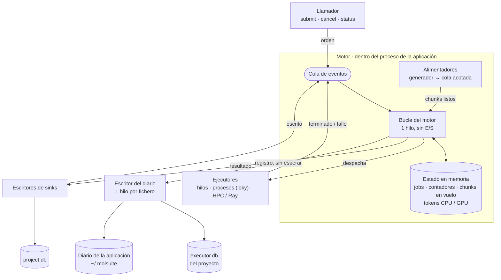
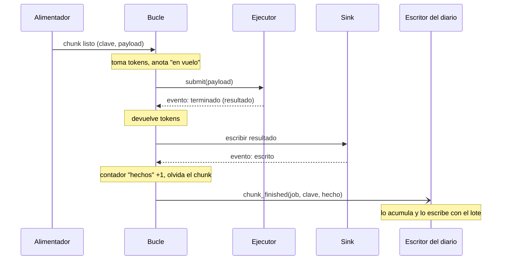
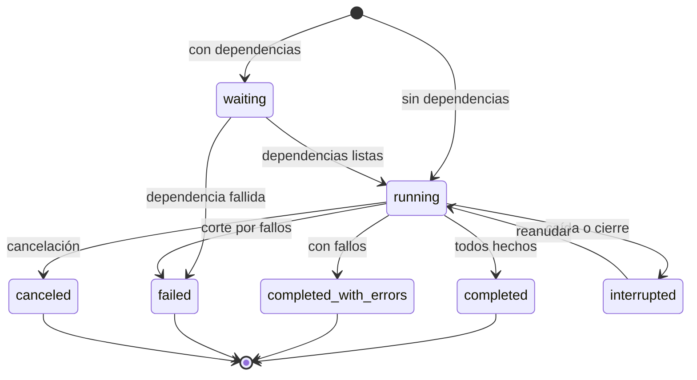

# Diseño del motor de ms_flow

Estado: construido. El motor nuevo es el único desde el 2026-10-08 (el anterior se borró en la rama `refactor/delete-old-engine`); lo que cambió al construir está en «Estado a 2026-10-08». Parte de los hallazgos de [01-auditoria.md](01-auditoria.md) y de las decisiones del 2026-10-07. El flujo de trabajo por rama y PR está en el [README](../README.md).

## Resumen

El motor pasa a ser uno por proceso, sin proyecto, con su estado en memoria. SQLite deja de ser su memoria de trabajo y se convierte en un diario que un hilo aparte escribe por lotes. Cada job elige dónde se registra: en ningún sitio, en el `executor.db` de un proyecto o en un diario de la aplicación.

Lo que se conserva: la interfaz pública de `ExecutorManager` que usa AMDockVS (`submit_job`, `cancel_job`, `get_job`, `list_jobs`, `register_*_executor`), los adaptadores de ejecución, los manejadores de resultados, los sinks y la admisión por tokens de CPU y GPU. La capa de datos (`project.db`) no se toca.

Lo que cambia, en una frase por pieza:

| Pieza | Hoy | Después |
| --- | --- | --- |
| Fuente de verdad | Tablas de `executor.db`, releídas en cada tick | Diccionarios en memoria del motor |
| `executor.db` | Memoria de trabajo: 12 a 16 sentencias y unos 3 commits por chunk | Diario: una fila por chunk terminado, en un lote por intervalo |
| Acceso a SQLite del motor | SQLModel, una sesión por operación | `sqlite3` directo, un hilo escritor, `executemany` |
| Estado del job | 8 agregados sobre todos sus chunks, varias veces por tick | Contadores que se suman al terminar cada chunk |
| Bucle | Sondeo cada 20 a 100 ms de todos los chunks en vuelo | Se despierta cuando llega un evento |
| Vida del motor | Uno por proyecto; cambiar de proyecto lo para | Uno por proceso; los proyectos conectan y desconectan su diario |
| Job sin proyecto | Imposible ("Activate a project first") | Normal: diario `none` o el de la aplicación |
| Job interrumpido | `failed`, sin reanudación | `interrupted`, se reanuda ejecutando solo lo que falta |

## Qué se pide al motor

Un usuario, pocos jobs a la vez, cada uno con cientos a millones de chunks. De ahí salen los objetivos, que son las puertas de la fase 2 de la auditoría (objetivos, no medidas):

- 0,2 ms o menos de orquestación por chunk con diario, 0,05 ms sin él. Hoy: 4,2 ms en hilos y 5,6 ms en procesos.
- Coste por chunk plano (±10 %) de 1.000 a 1.000.000 de chunks. Hoy crece 2,4 veces dentro de un job de 20.000.
- Menos de 0,3 KB en disco por chunk. Hoy: 1,44 KB.
- Tras `kill -9` y reabrir, el job se reanuda, termina con todos sus chunks y solo repite los del último lote sin registrar.
- La muerte de un worker afecta a un chunk, no al job ni a los siguientes.

## Componentes



El bucle es el único que cambia el estado. Todo lo demás le habla por la cola de eventos, y el bucle nunca espera a que el disco responda. El llamador lee el estado como una instantánea, sin pasar por la cola.

### 1. Motor (`Engine`)

Un objeto dentro del proceso de la aplicación (la app, un script o un notebook), en lugar de uno por proyecto como hoy. Los procesos worker no levantan motor ni monitoreo: ejecutan la función y devuelven el resultado. Solo un motor por usuario reparte los recursos locales: al crearse toma un bloqueo del sistema operativo sobre `engine.lock`, en la carpeta de estado que le pasa la aplicación. Un segundo proceso recibe un error con el pid del dueño, para que dos aplicaciones no compitan por CPU, GPU y memoria. Un script puede saltarse el bloqueo con `exclusive=False`, declarando sus CPUs, bajo su responsabilidad. Posee los ejecutores registrados, los tokens de CPU y GPU, el estado de los jobs y el hilo del bucle. Se crea al arrancar la aplicación o al primer uso, y no necesita proyecto.

- **Hoy.** `ExecutorManager` se construye con el `executor.db` de un proyecto (`_create_executor_manager` en `project_runtime.py`) y `stop()` al cambiar de proyecto. Sin proyecto no existe, y por eso las instalaciones de herramientas corren fuera del orquestador.
- **Cambio.** El motor no recibe ninguna base de datos al construirse. Recibe diarios después, con `attach` y `detach`, y cada job dice cuál usa.
- **Por qué.** Es lo que permite los jobs de aplicación (`ms_env`), los scripts sin proyecto y que cambiar de proyecto no pare el motor, sus pools ni los jobs de aplicación.

### 2. Estado en memoria

Dos estructuras, las dos propiedad exclusiva del bucle:

- **Job.** Especificación (ejecutor, función, coste en CPU, GPU y memoria, ventana, nivel de durabilidad, reintentos), fase, contadores (`total`, `en vuelo`, `hechos`, `fallidos`, `cancelados`), posición del generador y dependencias.
- **Chunk en vuelo.** Clave, número de orden local, intento, estado, asa del ejecutor y hora límite.

Solo se guardan en memoria los chunks en vuelo. Uno terminado suma a un contador y desaparece. La memoria del motor es proporcional a la ventana, no al tamaño del job.

- **Hoy.** El motor relee de SQLite en cada tick lo que ya sabe: ids activos, candidatos a despachar (filas ORM completas con su payload, `LIMIT 200`) y la fila del job. El estado del job sale de 8 agregados sobre todos sus chunks (`build_job_runtime_metrics`).
- **Cambio.** Ningún `SELECT` en el bucle. El estado del job es `O(1)`: se lee de los contadores.
- **Por qué.** Es la causa 1 y 3 del overhead y la causa de que el coste crezca con el tamaño del job.

**Identidad del chunk.** Un chunk se identifica por `(job, clave)`. La clave es un hash de 16 bytes (`blake2b`) del payload ya convertido a formato de transporte, que el alimentador calcula; un generador que conozca una clave mejor la entrega en `_key`, como hoy `_cpu_required`. Sustituye al `uuid4` actual, que no significa nada entre ejecuciones. La posición en la secuencia no sirve de identidad: el filtro `skip_existing` de docking desplaza todo el flujo al relanzar. Dos chunks con el mismo payload dentro de un job cuentan como uno al reanudar.

### 3. Bucle del motor

Un hilo que espera en una cola y procesa eventos: orden recibida (envío, cancelación), chunk terminado, chunk fallido, resultado escrito, chunks listos, y un temporizador para tiempos límite y reintentos.

En cada evento hace tres cosas: actualiza el estado, devuelve o toma tokens y decide qué chunks salen. No hace SQL, no escribe resultados, no ejecuta el generador del usuario y no llama a nada que pueda bloquear.

- **Hoy.** `_run_loop` hace en cada tick: sondeo de todos los chunks en vuelo (`adapter.poll` uno a uno), finalización de despachos (2 sesiones, 2 `SELECT` y 2 commits por chunk), ciclo de staging, sinks, flush de persistencia, alimentación, despacho, progreso, eventos y latidos. Después duerme 20 a 100 ms.
- **Cambio.** Los ejecutores avisan al terminar (`add_done_callback` pone un evento en la cola). El bucle no sondea ni duerme con tareas pendientes.
- **Cola y sondeo.** No hay gestor de eventos propio: es una `queue.SimpleQueue` de la biblioteca estándar y un bucle que saca de ella. Los eventos nunca viajan a los workers; los emite, en el proceso principal, el hilo que vigila a cada ejecutor (ver «Ejecutores»). El sondeo queda solo donde la fuente no puede avisar: HPC, cuando exista, y los tiempos límite. `blinker` no interviene en el motor: `send` ejecuta los receptores en el hilo que emite, sin relevo entre hilos. Sigue para lo que ya hace (ajustes, proyecto abierto y cerrado).
- **Por qué.** El tick añade unos 50 ms al arranque de cada job y hasta un tick por finalización. En procesos, el hilo está saturado de CPU haciendo SQL, y por eso ningún ajuste mueve su coste.

### 4. Alimentadores

Un hilo por job activo con generador (o un pool pequeño). Ejecuta el generador del usuario, prepara el payload y lo deja en una cola acotada del tamaño de la ventana. Cuando la cola está llena, el generador se detiene solo.

- **Hoy.** `feed_window` corre en el hilo del motor, inserta filas de chunk por ventana y cuenta los activos con otro `SELECT`.
- **Cambio.** El generador sale del bucle. No se crean filas de chunk antes de ejecutar: el payload va del generador al ejecutor sin pasar por la base de datos.
- **Por qué.** Un generador lento (lee de `project.db`) bloquea hoy a todos los jobs. Y es lo que elimina el payload de `executor.db`.

La etapa por chunk (`stage_ref`) encaja aquí: generador → etapa → cola de listos. El estado `staging` deja de existir como estado persistido. Por verificar contra `lifecycle_controller.py` al implementarlo; `setup_ref` y `finalize_ref` siguen siendo fases del job.

### 5. Tokens y planificación

Contadores de CPU, GPU y memoria libres. Un chunk sale si hay tokens para su coste en los tres, si su job no supera su `max_job_cpu` y si su ventana tiene hueco. Entre jobs se respeta prioridad y política de cola como hoy.

- **Hoy.** La lógica está repartida en tres módulos (`local_scheduler.py`, `local_compute_scheduler.py`, `resource_manager.py`) más consultas a la base de datos para saber el uso por job.
- **Cambio.** Un módulo, todo en memoria. La ventana por defecto pasa de 16 fijo a un múltiplo de los workers del ejecutor.
- **Por qué.** Con 28 hilos o 14 procesos, 16 deja workers sin alimentar.

**Memoria.** Hoy la admisión solo mira CPU y GPU. `memory_gb` existe en los modelos de configuración y no lo usa nadie. Con Vina o GNINA por encima de 1 GB por docking, una máquina con tantos GB como núcleos se satura.

Un tercer contador en el módulo de tokens.

- **Coste declarado por chunk** (`mem_mb`), igual que `cpu_required`. Un job que no lo declara no cuenta memoria y se comporta como hoy. Lo declara quien conoce la herramienta (AMDock para docking), no el motor.
- **Presupuesto** = RAM física menos una reserva: por defecto el 20 % con un mínimo de 2 GB, ajustable en configuración. La RAM total sale de `os.sysconf` (Windows necesita una llamada con `ctypes`); sin dependencia nueva.
- **Admisión**: un chunk sale si hay CPU, GPU y memoria. La concurrencia efectiva pasa a ser el mínimo de núcleos y `presupuesto / mem_mb`.
- **El mismo dato sirve fuera**: se pasa a Ray como `memory=` y a la plantilla de HPC como `--mem`.
- **Medición**: el worker devuelve su pico de memoria (`resource.getrusage`, incluye subprocesos) y el job lo muestra, para corregir el valor declarado.

Fuera de la primera versión: ajustar la reserva sola a partir del pico medido, y frenar el despacho según la memoria libre real del sistema (otras aplicaciones no cuentan en el presupuesto).

### 6. Ejecutores

Los adaptadores de hilos, procesos, Ray y HPC se quedan. Cambian tres cosas:

- **Aviso en lugar de sondeo.** Los locales notifican por callback. Los externos (HPC, Ray) se sondean en lote desde un hilo propio, no desde el bucle.
- **Pool que se recupera.** Ante `BrokenProcessPool` el adaptador recrea el pool y devuelve al motor los chunks que no llegaron a ejecutarse para que los reencole. Hoy `_reset_pool_locked` solo se llama desde `cancel`.
- **Workers que mueren con el padre.** Cada worker vigila al proceso principal y termina si desaparece.

**Un contrato para todos.** El adaptador recibe al registrarse una función `on_done(asa, estado, resultado, error)` y deja de exponer `poll`. Quién la llama depende del ejecutor; el bucle no distingue local de remoto.

| Ejecutor | Quién avisa | Tokens locales |
|---|---|---|
| Hilos, procesos (loky) | El hilo del propio pool que recibe los resultados; `add_done_callback` solo le hace dejar el evento en la cola | Por chunk (`dynamic`, como hoy) |
| Ray local | Un hilo vigía bloqueado en `ray.wait` sobre todas las referencias | Una porción fija reservada al activar (`reserved`, como hoy); Ray reparte dentro de ella |
| Ray remoto | El mismo hilo vigía | Ninguno |
| HPC | Un hilo que sondea: ficheros de estado primero, después una consulta al planificador para todos sus jobs | Ninguno |

En los cuatro casos quien avisa es un hilo del proceso principal que espera a los workers. En loky ese hilo ya existe dentro del pool: es el que lee la tubería de resultados y completa el `Future`. El callback se registra en el proceso principal y no viaja al worker. Hoy el adaptador guarda los `Future` y el bucle pregunta `future.done()` uno a uno.

Hoy `poll` de HPC lanza un `subprocess.run` por chunk dentro del hilo del motor, y `poll` de Ray hace un `ray.wait(timeout=0)` por referencia. La ventana de un ejecutor externo sale de la capacidad que declare el adaptador, no de los tokens locales. HPC y Ray siguen aplazados; lo que se fija ahora es el contrato.

Agrupación automática: cuando la duración medida de los chunks es corta, el adaptador de procesos empaqueta varios en una tarea. El chunk sigue siendo la unidad de progreso, reintento y diario.

### 7. Diario (`Journal`)

Una interfaz pequeña que el bucle llama para registrar, sin esperar respuesta:

| Llamada | Cuándo |
| --- | --- |
| `job_created(job)` | Al aceptar el envío |
| `job_changed(job)` | Cambio de fase o de contadores, como mucho una vez por lote |
| `chunk_finished(job, clave, estado, intento, error)` | Chunk terminado (bien, mal, cancelado, tiempo agotado) |
| `event(job, tipo, datos)` | Eventos de job siempre; eventos por chunk solo en nivel `full` |
| `flush()` | Barrera: al terminar un job y al cerrar |
| `load()` | Al conectar: jobs y chunks terminados, para reanudar |
| `compact(job)` | Al terminar un job |

Dos implementaciones: una nula (no hace nada) y una SQLite.

**Diario SQLite.** Un hilo escritor por fichero. Recibe registros por una cola acotada, los acumula y los escribe con `executemany` en una transacción por intervalo (valor inicial 50 ms, a ajustar midiendo) o al llegar a un tamaño de lote. `sqlite3` de la biblioteca estándar, WAL, `synchronous=NORMAL`, esquema por DDL y `PRAGMA user_version`. Si el disco va más lento que el motor, la cola llena frena el despacho en lugar de crecer.

Esquema, tres tablas en lugar de las cinco actuales (`executor_jobs`, `executor_job_feeds`, `executor_job_chunks`, `executor_job_events`, `executor_heartbeats`):

```sql
CREATE TABLE jobs (
    n INTEGER PRIMARY KEY,           -- número corto, clave de las otras tablas
    job_id TEXT UNIQUE NOT NULL,
    status TEXT NOT NULL,
    spec TEXT NOT NULL,              -- JSON: ejecutor, función, generador, opciones
    total INTEGER, done INTEGER, failed INTEGER, canceled INTEGER,
    error TEXT, owner TEXT,
    created_at REAL, started_at REAL, finished_at REAL
);
CREATE TABLE chunks (
    job INTEGER NOT NULL, key BLOB NOT NULL,     -- 16 bytes
    status INTEGER NOT NULL, attempt INTEGER NOT NULL, error TEXT,
    PRIMARY KEY (job, key)
) WITHOUT ROWID;
CREATE TABLE events (job INTEGER, ts REAL, kind TEXT, data TEXT);
```

- **Hoy.** Fila de chunk de 22 columnas con 7 índices de una columna, el único de `chunk_id` y la clave primaria UUID; payload dentro de la fila; 2 eventos por chunk; latidos cada 0,5 s; motivo del planificador persistido.
- **Cambio.** La fila de chunk son la clave, tres enteros y un error opcional, con un solo índice (la clave). Se escribe una vez, al terminar. El payload no se registra nunca: lo regenera el generador. Al terminar el job, `compact` borra las filas de chunks terminados bien y deja los contadores en la fila del job; las de fallos se quedan, con su error.
- **Por qué.** En el microbenchmark de la auditoría, las tres transiciones de un chunk cuestan 738 µs con el ORM y 99 µs con `sqlite3` directo y despacho agrupado. El diario hace una sola escritura por chunk, y por lotes. Y es la respuesta al tamaño de `executor.db`: un job terminado ocupa una fila más sus fallos.

**Qué se puede perder.** En una caída se pierde como mucho el último lote sin escribir. Esos chunks constan como no terminados y se vuelven a ejecutar al reanudar. La garantía es "al menos una vez". Un chunk se registra como hecho después de que su sink confirme la escritura, así que el caso malo es: resultado escrito, registro perdido, chunk repetido. El contrato que ya existe para AMDockVS (escrituras idempotentes: upsert o saltar lo existente) lo cubre y sigue siendo obligatorio.

### 8. Dónde se registra cada job

| Destino | Qué es | Para qué |
| --- | --- | --- |
| `none` | Sin diario. Ni fichero ni SQLite en memoria | `map` en scripts y notebooks, tareas desechables |
| Proyecto | El `executor.db` del proyecto | Campañas. El historial viaja con los datos |
| Aplicación | Un diario en `~/.molsuite` | Jobs sin proyecto: instalación de herramientas y entornos de `ms_env` |

Como mucho hay dos diarios abiertos: el del proyecto activo y el de la aplicación. Cerrar un proyecto interrumpe sus jobs (quedan `interrupted`, reanudables), espera a que sinks y diario terminen de escribir y desconecta el diario. Del proyecto no queda nada en el motor; el motor, sus pools y los jobs de aplicación siguen. Seguir ejecutando jobs de un proyecto cerrado queda descartado: obligaría a mantener por job sus conexiones a `project.db` y a aislar esas piezas por proyecto dentro del motor.

`project.db` y `executor.db` son del proyecto y cambian con él. El motor no guarda ninguna conexión propia a `project.db`: cada job trae sus destinos. Los workers nunca abren la base de datos (SQLite no admite escritores concurrentes): reciben el payload y devuelven el resultado; leen el generador y la etapa, y escriben los sinks, todos en el proceso principal. Por eso el pool de workers no guarda nada del proyecto y sigue vivo al cambiar. Al cerrar el proyecto A se cierran sus conexiones en el proceso principal, y eso incluye una cosa que hoy no se hace: vaciar la caché de conexiones por ruta (`dispose_cached_engines` en `core/database/base.py` no tiene ningún llamador). Lo que sobrevive al cambio no es de ningún proyecto: el objeto motor, sus pools, los tokens y el diario de la aplicación.

Las dependencias entre jobs (`depends_on`) se resuelven en memoria, entre jobs de cualquier diario. Un job de docking de un proyecto puede esperar a un job de instalación registrado en el diario de la aplicación. La puerta `tool:<nombre>@<destino>` sigue consultando el estado de la herramienta, como hoy.

**Propietario.** Cada fichero de diario tiene un dueño: un bloqueo del sistema operativo sobre `executor.db.lock` (`fcntl.flock` en POSIX, `msvcrt.locking` en Windows). El kernel lo libera al morir el proceso, así que no quedan bloqueos huérfanos ni hay confusión por reutilización de pid; pid, máquina y arranque se escriben solo para el mensaje. Un segundo proceso abre el proyecto sin motor para él: ve datos y monitor (diario en solo lectura), no lanza jobs ni toca su estado. Hoy el segundo proceso marca como fallidos los jobs vivos del primero. Techo: sistemas de ficheros en red donde `flock` no es fiable.

### 9. Niveles de durabilidad

Un parámetro por job. Decide qué llamadas llegan al diario.

| Nivel | Se registra | Sobrevive a una caída |
| --- | --- | --- |
| `none` | Nada | Nada |
| `journal` (por defecto) | Jobs, estado final de cada chunk, errores, eventos de job | Todo salvo el último lote, que se reejecuta |
| `full` | Lo anterior más eventos por chunk y tiempos | Igual, con traza completa |

`none` con un destino de proyecto no tiene sentido y se rechaza al enviar.

### 10. Resultados y sinks

Sin cambios de concepto. El bucle entrega el resultado al manejador o al pool de escritores de sinks, que escribe en `project.db` fuera del bucle y avisa por la cola. El chunk cuenta como hecho al confirmarse la escritura. Si los sinks se atrasan, el job deja de despachar (la presión por cuota que ya existe).

### 11. Observación

- **Dentro del proceso.** `status(job)` devuelve una instantánea de los contadores en memoria. El monitor mantiene su temporizador (`ms_monitor/polling.py`), pero lee instantáneas en memoria en lugar de consultas SQL: observar no cuesta nada al motor. Señales de `blinker` para jobs solo si un consumidor llega a necesitar aviso en lugar de pregunta.
- **Desde otro proceso** (línea de comandos, otro monitor). Lee el diario en solo lectura. Ve los contadores con el retraso de un lote. En nivel `journal` no hay detalle de chunks en ejecución; en `full`, sí.

- **Hoy.** `get_job` y el monitor consultan la base de datos, y `refresh_job_status` cuesta 11 ms por llamada.

## Vida de un chunk



Coste para el motor: dos pasos por la cola y unas operaciones de diccionario. El disco lo toca otro hilo, una vez por lote.

Con fallo: el ejecutor avisa del error; si quedan intentos, el chunk vuelve a la cola de listos con el intento siguiente tras la espera; si no, suma a `fallidos` y se registra con su error. Con tiempo agotado: el temporizador avisa, el motor cancela el asa (en procesos, mata al worker y el pool se recupera) y lo trata como un fallo de infraestructura.

## Estados de un job



`failed` queda para el job que no llegó a arrancar o que se cortó por ratio de fallos. Dos estados nuevos: `interrupted` (reanudable, distinto de `failed`) y `completed_with_errors` (hoy un job con el 90 % correcto es `failed` y sin mensaje). `job.error` lleva un resumen de los errores más frecuentes.

## Reanudación

1. Al conectar un diario, el motor carga los jobs no terminados y los deja en `interrupted`. Nunca relanza nada solo: reanudar es una acción explícita.
2. Reanudar necesita otra vez la fuente de chunks:
   - Si el job se envió con un generador importable, su referencia está en `spec` y el motor lo reanuda solo.
   - Si se envió con una lista o un iterador en memoria, quien lo envió lo vuelve a enviar con la misma clave de job. El motor reconoce el job y continúa.
3. El motor carga del diario el conjunto de claves terminadas, vuelve a recorrer el generador y salta los chunks cuya clave está en él. Ejecuta solo lo que falta.

La regla es: ante la duda se repite; nunca se salta algo que no esté probado como hecho. Si el flujo cambia entre ejecuciones (filas nuevas, límites de chunk desplazados), las claves dejan de coincidir y esos chunks se repiten. Repetir es seguro porque la escritura idempotente en los sinks es contrato.

Dos condiciones y un límite:

- El payload debe ser reproducible: sin rutas temporales, horas ni identificadores aleatorios. Si al reanudar la fuente no trae los chunks hechos, el motor no avisa (decidido el 2026-10-08): quien envía puede haberlos excluido a propósito. Lo que el job tenía hecho cuenta igual, y el total es hechos + pendientes.
- La garantía sigue siendo «al menos una vez». Un chunk escrito cuyo registro se perdió con el último lote se repite; con un sink que no sea idempotente, se duplica.
- Un job que ya filtra lo hecho en su fuente de datos (`skip_existing` en docking) no necesita las claves: su flujo ya solo trae lo que falta. Las dos cosas conviven.

Contrastado con las dos fuentes reales de AMDockVS:

- **Base de datos.** `db_pages` pagina con `ORDER BY key`: mismo orden y mismos lotes mientras no cambien las filas.
- **Fichero.** El proceso principal lee el fichero en secuencia y corta por bytes y registros (`stream_import_payload_batches`); el worker no elige su trozo. El payload lleva `file_path`, `span_offset`, `span_end` y `span_first_index`, así que la clave identifica un tramo exacto del fichero. Guarda necesaria: el job anota tamaño y fecha del fichero, y si cambian al reanudar se descartan las claves hechas.

Hoy `resubmit_job` exige un generador persistido y empieza desde el cursor 0.

## Qué hilo hace qué

| Hilo | Cuántos | Hace | No hace |
| --- | --- | --- | --- |
| Llamador | Los del usuario | Deja órdenes en la cola, lee instantáneas | Tocar el estado |
| Bucle | 1 | Transiciones, tokens, elegir qué sale | E/S, SQL, código del usuario |
| Alimentador | 1 por job con generador | Generador, etapa, payload | Decidir cuándo se despacha |
| Workers | Los del pool | La función del chunk | — |
| Escritor del diario | 1 por fichero abierto | Lotes a SQLite | Leer para el motor |
| Escritores de sinks | El pool actual | Resultados a `project.db` | — |
| Sondeo externo | 1, solo si hay HPC o Ray | Estado de tareas remotas, en lote | — |

## Frontera con `ms_projects` y `ms_env`

- **`ms_flow`** se queda con el motor, los ejecutores y la capa de datos (sinks, consultas). No sabe qué es un proyecto: recibe la ruta de un diario y los destinos de los sinks.
- **`ms_projects`** recibe proyectos y ajustes (`core/project`, `core/settings`, el registro de `~/.molsuite`). Al abrir un proyecto llama a `attach` con su `executor.db`; al cerrarlo, a `detach`.
- **`ms_env`** (nuevo) recibe las recetas de herramientas y la creación y gestión de entornos (`core/executor/tools.py`, `provisioning.py`). Envía sus instalaciones al motor como jobs con el diario de la aplicación y publica el estado que consulta la puerta `tool:`.

El orden importa: el motor sin proyecto (el núcleo, B1 de la lista siguiente) es el requisito de los dos traslados. Su planificación va en documentos aparte.

## Cambios, en el orden propuesto

El motor nuevo se construye entero en `ms_flow/engine/`, al lado del actual, que no se toca hasta el relevo. Cada pieza es una rama local con su test y su paso en [03-impacto.html](03-impacto.html), medido con el mismo banco de pruebas contra la línea base y contra los objetivos. Si los números y las comprobaciones acompañan, la fachada pasa al motor nuevo y el anterior se borra.

| N.º | Cambio | Tareas que absorbe | Qué debería mover en el informe |
| --- | --- | --- | --- |
| 0 | Banco de pruebas, línea base y estos documentos | — | Columna `baseline` |
| B1 | Núcleo: estado en memoria, tokens de CPU, GPU y memoria, bucle por cola, contrato `on_done` con hilos y loky, pool que se recupera, workers que mueren con el padre | F0-1, F0-3, F1-4, F2-1, F2-4, F2-5 | `thread`, `process`, `large job`, `growth`; muerte de worker y `kill -9` |
| B2 | Alimentadores fuera del bucle; clave de contenido; coste y clave por chunk (`_cpu_required`, `_key`) | F2-1 | `process`, `large job` |
| B3 | Diario con `sqlite3` directo, hilo escritor, esquema compacto y compactación; dueño por fichero y un solo motor local por usuario | F2-3, F2-8, F1-3 | `state`; segundo motor |
| B4 | Reanudación por clave, `interrupted`, dependencias entre jobs, niveles de durabilidad, cierre de proyecto que interrumpe | F2-7, F1-5, F1-6, F3-2 | Comprobación nueva de reanudación |
| B5 | Reintentos y tiempo máximo por chunk; matar un chunk en ejecución (también al cancelar) | F1-1, F1-2 | Comprobaciones nuevas |
| B6 | Agrupación automática | F2-6 | `process` |
| C1 | Relevo: `job_api.py`, `tasking.py` y `project_runtime.py` pasan al motor nuevo, con sinks, etapas, `setup` y `finalize` | F2-2 | Ninguna métrica; se acepta con los flujos de AMDockVS de punta a punta |
| C2 | Borrar el motor anterior y SQLModel del motor | F2-9, F2-10 | `import` |

**C1 y C2, hechos el 2026-10-08.** La fachada (`MolSuite.submit`, `MolSuite.engine`) corre solo sobre el motor nuevo y el diario del proyecto es su `executor.db`. C1 no se aceptó con los flujos de AMDockVS: se decidió borrar primero y portar AMDockVS después, así que queda roto hasta entonces. `setup`, `finalize` y los sinks a fichero no se han construido. La lista de lo borrado y de los huecos está en [05-diseno-tasks-jobs.md](05-diseno-tasks-jobs.md), «Hecho: borrado del motor anterior». `import ms_flow.api` pasa de unos 370 a unos 300 ms (5 repeticiones, máquina ocupada; falta el registro oficial).

Lo que desaparece respecto al plan de la auditoría: F0-2 (índice `(job_id, status)`) y F0-4 (eventos por chunk), porque la tabla y los eventos que arreglaban no existen en el motor nuevo. F0-5, F0-6 y F0-7 no tocan el motor y pueden ir en cualquier momento.

**Estado a 2026-10-08.** Hechos y medidos B1 a B6 (el bloque B entero), más un paso fuera de la tabla: el paquete `ms_flow` carga sus nombres al primer uso, para que un worker no importe toda la API (primer job de 563 a 80 ms). Cada uno es una rama local `refactor/*` y una columna del informe. Lo que cambió al construir:

- **Sin `exclusive=False`.** El motor toma `engine.lock` solo si recibe `state_dir`. Un script que no la pasa no bloquea ni es bloqueado; la aplicación la pasa siempre.
- **Nivel de durabilidad = `journal=` del job.** Sin diario es `none`; con diario es `journal`. El nivel `full` (eventos y tiempos por chunk) y la tabla `events` no se han construido: no hay todavía quien los lea.
- **Reanudar es volver a enviar con la misma `key`.** Continúa un job `interrupted` o `canceled`; uno que terminó de otra forma se rechaza. `discard(journal, key)` lo da por perdido: borra su fila y sus chunks hechos y deja libre la clave. Al continuar, sus chunks fallidos se repiten. Reanudar solo desde un generador importable guardado en `spec` queda para el relevo (C1), que es donde existen esos generadores.
- **Dependencias.** `after=[ids]`. Vale como terminado `completed` y `completed_with_errors`; `failed`, `canceled` e `interrupted` hacen fallar al que espera. La fuente de chunks del que espera no se lee hasta que arranca.
- **Agrupación (B6).** La hace el motor, no el adaptador: es quien reparte las fichas, y un paquete de chunks ocupa las de uno solo porque corren uno tras otro en un worker. El adaptador solo ofrece `submit_many`; el de hilos no lo ofrece. La duración se mide desde el motor, ida y vuelta incluidas, así un payload caro de enviar nunca cuenta como chunk corto. Objetivo de 10 ms por tarea, máximo 64 chunks. Si el job no fija `window`, crece con el paquete. Tras la muerte de un worker, los chunks del paquete se repiten de uno en uno.
- **Reintentos y tiempo máximo (B5).** `retries`, `retry_wait` y `timeout` por job. Gasta un intento lanzar una excepción, pasarse del tiempo o matar al propio worker; caer por culpa de otro chunk no gasta nada. La espera se duplica en cada intento. `on_error` solo se entera del fallo definitivo; `chunks_retried` cuenta los reintentos del job. Cortar un chunk es matar el pool entero, porque loky da por perdido el pool cuando muere un worker: los demás chunks en vuelo vuelven a la cola sin coste para sus intentos, pero pierden lo que llevaban hecho. Cancelar un job hace lo mismo. El ejecutor de hilos no puede matar: no admite `timeout` y sus chunks en marcha terminan solos.
- **Memoria.** Al reanudar, cada clave se busca en el fichero del diario en lugar de cargar todas las hechas: con 1,8 millones de chunks hechos el pico baja de 232 a 35 MB, a cambio de 5 a 7 µs por chunk de la fuente. Un payload igual a otro ya hecho en la misma ejecución también se salta. Un job terminado se suelta del motor (función y callbacks incluidos); queda su última foto, para los 1.000 jobs terminados más recientes.
- **Ventana elástica, medida.** Con 14 workers y una fuente que no espera (payloads con `_key`, sin calcular la clave): payloads de 10 KB, 52 MB de pico frente a 26 con ventana fija de 28, y el doble de rápido; de 100 KB, 87 MB frente a 45, sin ganancia de tiempo; de 1 MB, igual en ambos (el paquete baja a 1 o 2). Con la clave calculada por el motor la fuente va más lenta que el pool y la ventana no llega a llenarse: de 1 KB a 1 MB la diferencia es de 0 a 4 MB. No se limita. Si hiciera falta, el límite sería un presupuesto en bytes de lo leído por adelantado.
- **Pendiente para más adelante.**
  - Un `executor.db` de formato antiguo da error y pide apartar el fichero. Como su contenido es efímero, la sustitución podrá hacerse conciliada con el usuario cuando haya usuarios con ficheros viejos.
  - **Pool de procesos propio**, aplazado el 2026-10-08 hasta que los fallos de loky aprieten. Un proceso por worker con su canal: el motor sabe qué chunk lleva cada uno, corta solo el que se pasa de tiempo y la muerte de un worker cuesta un chunk, sin repetir en serie los demás. Hoy, con loky, matar un worker (a mano o por falta de RAM) tira el pool: 24 chunks de 1 s en 8 workers pasan de 3,1 a 10,6 s, sin perder ninguno. No rompe nada hacia fuera: queda detrás del contrato del ejecutor (`submit`, `submit_many`, `kill`), con el mismo nombre `ProcessExecutor`, y permite borrar del motor los sospechosos y el rearranque en serie. Debe seguir enviando las funciones con `cloudpickle`, como hace loky.
- **Compactación.** Al terminar un job, salvo interrumpido o cancelado, se borran sus chunks hechos y se devuelven las páginas al sistema (`auto_vacuum=INCREMENTAL`). Cuesta unos 2,5 s por millón de chunks, una vez, al final.

**Objetivos con los que se compara.** Orquestación por chunk ≤ 0,05 ms sin diario y ≤ 0,2 ms con él; coste plano (±10 %) de 1.000 a 1.000.000 de chunks; menos de 0,3 KB por chunk en disco; tras un `kill -9` el job se reanuda y solo repite el último lote sin registrar; la muerte de un worker cuesta un chunk.

## Decisiones cerradas (2026-10-07)

- **Historial de los `executor.db` actuales.** No se migra nada. El proyecto está en desarrollo activo y los cambios de esquema son esperados: el esquema nuevo sustituye al anterior.
- **Ruta del diario de la aplicación.** La fija la aplicación que invoca `ms_flow`; el motor solo recibe una ruta.
- **Reintentos y tiempo máximo por chunk (F1-1, F1-2).** Van detrás del estado en memoria (B5).
- **Identidad del chunk.** Clave por contenido, no índice. Ver «Estado en memoria» y «Reanudación».
- **Cerrar un proyecto con jobs activos.** Los interrumpe y deja el motor limpio para el siguiente proyecto. No hay jobs en segundo plano de proyectos cerrados. Ver «Dónde se registra cada job».
- **Memoria como tercer recurso.** Aprobada. Entra con el núcleo (B1). Ver «Tokens y planificación».
- **Dos aplicaciones a la vez.** No comparten recursos: un solo motor local por usuario, con bloqueo. Sin reparto entre procesos ni servicio.
- **Eventos.** Cola estándar dentro del motor; `blinker` fuera de él; sondeo solo para HPC y tiempos límite.
- **Método (2026-10-08).** Motor nuevo al lado del actual, comparado con la línea base y con los objetivos; si va bien, se muda todo a él. No se arregla antes el motor actual.

## Decisiones abiertas

Ninguna.
