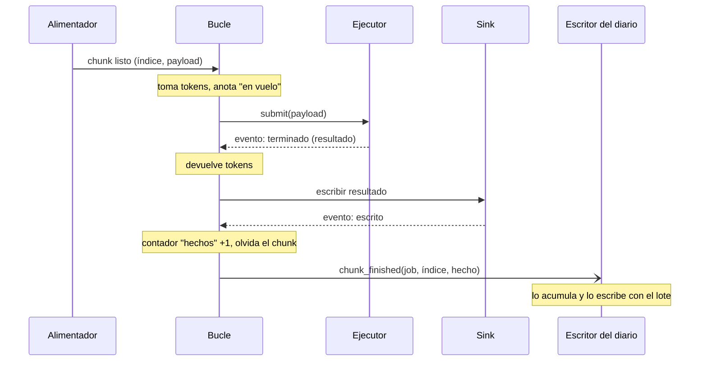
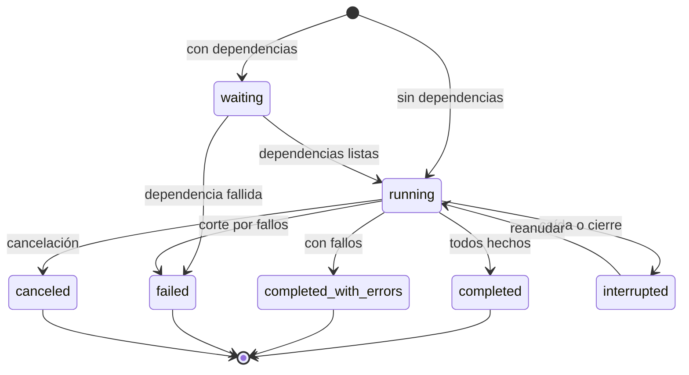

# Diseño del motor de ms_flow

Estado: propuesta para discutir. No hay código del motor nuevo. Parte de los hallazgos de [01-auditoria.md](01-auditoria.md) y de las decisiones del 2026-10-07. El flujo de trabajo por rama y PR está en el [README](../README.md).

## Resumen

El motor pasa a ser uno por proceso, sin proyecto, con su estado en memoria. SQLite deja de ser su memoria de trabajo y se convierte en un diario que un hilo aparte escribe por lotes. Cada job elige dónde se registra: en ningún sitio, en el `executor.db` de un proyecto o en un diario de la aplicación.

Lo que se conserva: la interfaz pública de `ExecutorManager` que usa AMDockVS (`submit_job`, `cancel_job`, `get_job`, `list_jobs`, `register_*_executor`), los adaptadores de ejecución, los manejadores de resultados, los sinks y la admisión por tokens de CPU y GPU. La capa de datos (`project.db`) no se toca.

Lo que cambia, en una frase por pieza:

| Pieza | Hoy | Después |
| --- | --- | --- |
| Fuente de verdad | Tablas de `executor.db`, releídas en cada tick | Diccionarios en memoria del motor |
| `executor.db` | Memoria de trabajo: 12 a 16 sentencias y unos 3 commits por chunk | Diario: una fila por chunk terminado, en un lote por intervalo |
| Acceso a SQLite del motor | SQLModel, una sesión por operación | `sqlite3` directo, un hilo escritor, `executemany` |
| Estado del job | 8 agregados sobre todos sus chunks, varias veces por tick | Contadores que se suman al terminar cada chunk |
| Bucle | Sondeo cada 20 a 100 ms de todos los chunks en vuelo | Se despierta cuando llega un evento |
| Vida del motor | Uno por proyecto; cambiar de proyecto lo para | Uno por proceso; los proyectos conectan y desconectan su diario |
| Job sin proyecto | Imposible ("Activate a project first") | Normal: diario `none` o el de la aplicación |
| Job interrumpido | `failed`, sin reanudación | `interrupted`, se reanuda ejecutando solo lo que falta |

## Qué se pide al motor

Un usuario, pocos jobs a la vez, cada uno con cientos a millones de chunks. De ahí salen los objetivos, que son las puertas de la fase 2 de la auditoría (objetivos, no medidas):

- 0,2 ms o menos de orquestación por chunk con diario, 0,05 ms sin él. Hoy: 4,2 ms en hilos y 5,6 ms en procesos.
- Coste por chunk plano (±10 %) de 1.000 a 1.000.000 de chunks. Hoy crece 2,4 veces dentro de un job de 20.000.
- Menos de 0,3 KB en disco por chunk. Hoy: 1,44 KB.
- Tras `kill -9` y reabrir, el job termina con todos sus chunks y ninguno terminado se repite.
- La muerte de un worker afecta a un chunk, no al job ni a los siguientes.

## Componentes


El bucle es el único que cambia el estado. Todo lo demás le habla por la cola de eventos, y el bucle nunca espera a que el disco responda. El llamador lee el estado como una instantánea, sin pasar por la cola.

### 1. Motor (`Engine`)

Un objeto por proceso. Posee los ejecutores registrados, los tokens de CPU y GPU, el estado de los jobs y el hilo del bucle. Se crea al arrancar la aplicación o al primer uso, y no necesita proyecto.

- **Hoy.** `ExecutorManager` se construye con el `executor.db` de un proyecto (`_create_executor_manager` en `project_runtime.py`) y `stop()` al cambiar de proyecto. Sin proyecto no existe, y por eso las instalaciones de herramientas corren fuera del orquestador.
- **Cambio.** El motor no recibe ninguna base de datos al construirse. Recibe diarios después, con `attach` y `detach`, y cada job dice cuál usa.
- **Por qué.** Es lo que permite los jobs de aplicación (`ms_env`), los scripts sin proyecto y que abrir otro proyecto no mate nada.

### 2. Estado en memoria

Dos estructuras, las dos propiedad exclusiva del bucle:

- **Job.** Especificación (ejecutor, función, coste en CPU y GPU, ventana, nivel de durabilidad, reintentos), fase, contadores (`total`, `en vuelo`, `hechos`, `fallidos`, `cancelados`), posición del generador y dependencias.
- **Chunk en vuelo.** Índice dentro del job, intento, estado, asa del ejecutor y hora límite.

Solo se guardan en memoria los chunks en vuelo. Uno terminado suma a un contador y desaparece. La memoria del motor es proporcional a la ventana, no al tamaño del job.

- **Hoy.** El motor relee de SQLite en cada tick lo que ya sabe: ids activos, candidatos a despachar (filas ORM completas con su payload, `LIMIT 200`) y la fila del job. El estado del job sale de 8 agregados sobre todos sus chunks (`build_job_runtime_metrics`).
- **Cambio.** Ningún `SELECT` en el bucle. El estado del job es `O(1)`: se lee de los contadores.
- **Por qué.** Es la causa 1 y 3 del overhead y la causa de que el coste crezca con el tamaño del job.

**Identidad del chunk.** Un chunk se identifica por `(job, índice)`, donde el índice es su posición en la secuencia que produce el generador. Sustituye al UUID y al `chunk_id` de texto. Esto impone un contrato: el generador debe producir la misma secuencia si se le vuelve a llamar. Ver decisiones abiertas.

### 3. Bucle del motor

Un hilo que espera en una cola y procesa eventos: orden recibida (envío, cancelación), chunk terminado, chunk fallido, resultado escrito, chunks listos, y un temporizador para tiempos límite y reintentos.

En cada evento hace tres cosas: actualiza el estado, devuelve o toma tokens y decide qué chunks salen. No hace SQL, no escribe resultados, no ejecuta el generador del usuario y no llama a nada que pueda bloquear.

- **Hoy.** `_run_loop` hace en cada tick: sondeo de todos los chunks en vuelo (`adapter.poll` uno a uno), finalización de despachos (2 sesiones, 2 `SELECT` y 2 commits por chunk), ciclo de staging, sinks, flush de persistencia, alimentación, despacho, progreso, eventos y latidos. Después duerme 20 a 100 ms.
- **Cambio.** Los ejecutores avisan al terminar (`add_done_callback` pone un evento en la cola). El bucle no sondea ni duerme con tareas pendientes.
- **Por qué.** El tick añade unos 50 ms al arranque de cada job y hasta un tick por finalización. En procesos, el hilo está saturado de CPU haciendo SQL, y por eso ningún ajuste mueve su coste.

### 4. Alimentadores

Un hilo por job activo con generador (o un pool pequeño). Ejecuta el generador del usuario, prepara el payload y lo deja en una cola acotada del tamaño de la ventana. Cuando la cola está llena, el generador se detiene solo.

- **Hoy.** `feed_window` corre en el hilo del motor, inserta filas de chunk por ventana y cuenta los activos con otro `SELECT`.
- **Cambio.** El generador sale del bucle. No se crean filas de chunk antes de ejecutar: el payload va del generador al ejecutor sin pasar por la base de datos.
- **Por qué.** Un generador lento (lee de `project.db`) bloquea hoy a todos los jobs. Y es lo que elimina el payload de `executor.db`.

La etapa por chunk (`stage_ref`) encaja aquí: generador → etapa → cola de listos. El estado `staging` deja de existir como estado persistido. Por verificar contra `lifecycle_controller.py` al implementarlo; `setup_ref` y `finalize_ref` siguen siendo fases del job.

### 5. Tokens y planificación

Contadores de CPU y GPU libres. Un chunk sale si hay tokens para su coste, si su job no supera su `max_job_cpu` y si su ventana tiene hueco. Entre jobs se respeta prioridad y política de cola como hoy.

- **Hoy.** La lógica está repartida en tres módulos (`local_scheduler.py`, `local_compute_scheduler.py`, `resource_manager.py`) más consultas a la base de datos para saber el uso por job.
- **Cambio.** Un módulo, todo en memoria. La ventana por defecto pasa de 16 fijo a un múltiplo de los workers del ejecutor.
- **Por qué.** Con 28 hilos o 14 procesos, 16 deja workers sin alimentar.

### 6. Ejecutores

Los adaptadores de hilos, procesos, Ray y HPC se quedan. Cambian tres cosas:

- **Aviso en lugar de sondeo.** Los locales notifican por callback. Los externos (HPC, Ray) se sondean en lote desde un hilo propio, no desde el bucle.
- **Pool que se recupera.** Ante `BrokenProcessPool` el adaptador recrea el pool y devuelve al motor los chunks que no llegaron a ejecutarse para que los reencole. Hoy `_reset_pool_locked` solo se llama desde `cancel`.
- **Workers que mueren con el padre.** Cada worker vigila al proceso principal y termina si desaparece.

Agrupación automática: cuando la duración medida de los chunks es corta, el adaptador de procesos empaqueta varios en una tarea. El chunk sigue siendo la unidad de progreso, reintento y diario.

### 7. Diario (`Journal`)

Una interfaz pequeña que el bucle llama para registrar, sin esperar respuesta:

| Llamada | Cuándo |
| --- | --- |
| `job_created(job)` | Al aceptar el envío |
| `job_changed(job)` | Cambio de fase o de contadores, como mucho una vez por lote |
| `chunk_finished(job, índice, estado, intento, error)` | Chunk terminado (bien, mal, cancelado, tiempo agotado) |
| `event(job, tipo, datos)` | Eventos de job siempre; eventos por chunk solo en nivel `full` |
| `flush()` | Barrera: al terminar un job y al cerrar |
| `load()` | Al conectar: jobs y chunks terminados, para reanudar |
| `compact(job)` | Al terminar un job |

Dos implementaciones: una nula (no hace nada) y una SQLite.

**Diario SQLite.** Un hilo escritor por fichero. Recibe registros por una cola acotada, los acumula y los escribe con `executemany` en una transacción por intervalo (valor inicial 50 ms, a ajustar midiendo) o al llegar a un tamaño de lote. `sqlite3` de la biblioteca estándar, WAL, `synchronous=NORMAL`, esquema por DDL y `PRAGMA user_version`. Si el disco va más lento que el motor, la cola llena frena el despacho en lugar de crecer.

Esquema, tres tablas en lugar de las cinco actuales (`executor_jobs`, `executor_job_feeds`, `executor_job_chunks`, `executor_job_events`, `executor_heartbeats`):

```sql
CREATE TABLE jobs (
    n INTEGER PRIMARY KEY,           -- número corto, clave de las otras tablas
    job_id TEXT UNIQUE NOT NULL,
    status TEXT NOT NULL,
    spec TEXT NOT NULL,              -- JSON: ejecutor, función, generador, opciones
    total INTEGER, done INTEGER, failed INTEGER, canceled INTEGER,
    error TEXT, owner TEXT,
    created_at REAL, started_at REAL, finished_at REAL
);
CREATE TABLE chunks (
    job INTEGER NOT NULL, idx INTEGER NOT NULL,
    status INTEGER NOT NULL, attempt INTEGER NOT NULL, error TEXT,
    PRIMARY KEY (job, idx)
) WITHOUT ROWID;
CREATE TABLE events (job INTEGER, ts REAL, kind TEXT, data TEXT);
```

- **Hoy.** Fila de chunk de 22 columnas con 7 índices de una columna, el único de `chunk_id` y la clave primaria UUID; payload dentro de la fila; 2 eventos por chunk; latidos cada 0,5 s; motivo del planificador persistido.
- **Cambio.** La fila de chunk son cuatro enteros y un error opcional, con un solo índice (la clave). Se escribe una vez, al terminar. El payload no se registra nunca: lo regenera el generador. Al terminar el job, `compact` borra las filas de chunks terminados bien y deja los contadores en la fila del job; las de fallos se quedan, con su error.
- **Por qué.** En el microbenchmark de la auditoría, las tres transiciones de un chunk cuestan 738 µs con el ORM y 99 µs con `sqlite3` directo y despacho agrupado. El diario hace una sola escritura por chunk, y por lotes. Y es la respuesta al tamaño de `executor.db`: un job terminado ocupa una fila más sus fallos.

**Qué se puede perder.** En una caída se pierde como mucho el último lote sin escribir. Esos chunks constan como no terminados y se vuelven a ejecutar al reanudar. La garantía es "al menos una vez". Un chunk se registra como hecho después de que su sink confirme la escritura, así que el caso malo es: resultado escrito, registro perdido, chunk repetido. El contrato que ya existe para AMDockVS (escrituras idempotentes: upsert o saltar lo existente) lo cubre y sigue siendo obligatorio.

### 8. Dónde se registra cada job

| Destino | Qué es | Para qué |
| --- | --- | --- |
| `none` | Sin diario. Ni fichero ni SQLite en memoria | `map` en scripts y notebooks, tareas desechables |
| Proyecto | El `executor.db` del proyecto | Campañas. El historial viaja con los datos |
| Aplicación | Un diario en `~/.molsuite` | Jobs sin proyecto: instalación de herramientas y entornos de `ms_env` |

El motor mantiene abiertos los diarios que tienen jobs. Abrir un proyecto conecta su diario; cerrarlo lo desconecta cuando no le quedan jobs activos. Los jobs de aplicación no se enteran.

Las dependencias entre jobs (`depends_on`) se resuelven en memoria, entre jobs de cualquier diario. Un job de docking de un proyecto puede esperar a un job de instalación registrado en el diario de la aplicación. La puerta `tool:<nombre>@<destino>` sigue consultando el estado de la herramienta, como hoy.

**Propietario.** Cada fichero de diario tiene un dueño (pid, máquina, arranque). Un segundo proceso que lo abra recibe un error con el PID del dueño, o lo abre en solo lectura para observar. Hoy el segundo proceso marca como interrumpidos los jobs del primero.

### 9. Niveles de durabilidad

Un parámetro por job. Decide qué llamadas llegan al diario.

| Nivel | Se registra | Sobrevive a una caída |
| --- | --- | --- |
| `none` | Nada | Nada |
| `journal` (por defecto) | Jobs, estado final de cada chunk, errores, eventos de job | Todo salvo el último lote, que se reejecuta |
| `full` | Lo anterior más eventos por chunk y tiempos | Igual, con traza completa |

`none` con un destino de proyecto no tiene sentido y se rechaza al enviar.

### 10. Resultados y sinks

Sin cambios de concepto. El bucle entrega el resultado al manejador o al pool de escritores de sinks, que escribe en `project.db` fuera del bucle y avisa por la cola. El chunk cuenta como hecho al confirmarse la escritura. Si los sinks se atrasan, el job deja de despachar (la presión por cuota que ya existe).

### 11. Observación

- **Dentro del proceso.** `status(job)` devuelve una instantánea de los contadores en memoria. La interfaz se suscribe a cambios en lugar de preguntar. Observar no cuesta nada al motor.
- **Desde otro proceso** (línea de comandos, otro monitor). Lee el diario en solo lectura. Ve los contadores con el retraso de un lote. En nivel `journal` no hay detalle de chunks en ejecución; en `full`, sí.

- **Hoy.** `get_job` y el monitor consultan la base de datos, y `refresh_job_status` cuesta 11 ms por llamada.

## Vida de un chunk



Coste para el motor: dos pasos por la cola y unas operaciones de diccionario. El disco lo toca otro hilo, una vez por lote.

Con fallo: el ejecutor avisa del error; si quedan intentos, el chunk vuelve a la cola de listos con el intento siguiente tras la espera; si no, suma a `fallidos` y se registra con su error. Con tiempo agotado: el temporizador avisa, el motor cancela el asa (en procesos, mata al worker y el pool se recupera) y lo trata como un fallo de infraestructura.

## Estados de un job



`failed` queda para el job que no llegó a arrancar o que se cortó por ratio de fallos. Dos estados nuevos: `interrupted` (reanudable, distinto de `failed`) y `completed_with_errors` (hoy un job con el 90 % correcto es `failed` y sin mensaje). `job.error` lleva un resumen de los errores más frecuentes.

## Reanudación

1. Al conectar un diario, el motor carga los jobs no terminados. Si su dueño ya no existe, pasan a `interrupted`.
2. Reanudar necesita otra vez la fuente de chunks:
   - Si el job se envió con un generador importable, su referencia está en `spec` y el motor lo reanuda solo.
   - Si se envió con una lista o un iterador en memoria, quien lo envió lo vuelve a enviar con la misma clave de job. El motor reconoce el job y continúa.
3. El motor carga del diario el conjunto de índices terminados, vuelve a recorrer el generador y salta esos índices. Ejecuta solo lo que falta.

Hoy `resubmit_job` exige un generador persistido y empieza desde el cursor 0.

## Qué hilo hace qué

| Hilo | Cuántos | Hace | No hace |
| --- | --- | --- | --- |
| Llamador | Los del usuario | Deja órdenes en la cola, lee instantáneas | Tocar el estado |
| Bucle | 1 | Transiciones, tokens, elegir qué sale | E/S, SQL, código del usuario |
| Alimentador | 1 por job con generador | Generador, etapa, payload | Decidir cuándo se despacha |
| Workers | Los del pool | La función del chunk | — |
| Escritor del diario | 1 por fichero abierto | Lotes a SQLite | Leer para el motor |
| Escritores de sinks | El pool actual | Resultados a `project.db` | — |
| Sondeo externo | 1, solo si hay HPC o Ray | Estado de tareas remotas, en lote | — |

## Frontera con `ms_projects` y `ms_env`

- **`ms_flow`** se queda con el motor, los ejecutores y la capa de datos (sinks, consultas). No sabe qué es un proyecto: recibe la ruta de un diario y los destinos de los sinks.
- **`ms_projects`** recibe proyectos y ajustes (`core/project`, `core/settings`, el registro de `~/.molsuite`). Al abrir un proyecto llama a `attach` con su `executor.db`; al cerrarlo, a `detach`.
- **`ms_env`** (nuevo) recibe las recetas de herramientas y la creación y gestión de entornos (`core/executor/tools.py`, `provisioning.py`). Envía sus instalaciones al motor como jobs con el diario de la aplicación y publica el estado que consulta la puerta `tool:`.

El orden importa: el motor sin proyecto (cambio 8 de la lista siguiente) es el requisito de los dos traslados. Su planificación va en documentos aparte.

## Cambios, en el orden propuesto

Cada fila es una rama y un PR, con su paso en [03-impacto.html](03-impacto.html). Las piezas nuevas van a un paquete `ms_flow/engine/`; cada PR borra de `ExecutorManager` lo que sustituye, y la fachada pública se mantiene hasta la fase 3.

| N.º | Cambio | Tarea | Qué debería mover en el informe |
| --- | --- | --- | --- |
| 0 | Banco de pruebas, línea base y estos documentos | — | Columna `baseline` |
| 1 | Recrear el pool tras la muerte de un worker y reencolar lo que no se ejecutó | F0-1 | 2 comprobaciones de muerte de worker |
| 2 | Ventana por defecto proporcional a los workers | F0-3 | `thread`, `process` |
| 3 | Eventos por chunk desactivados por defecto | F0-4 | `thread`, `state` |
| 4 | Índice `(job_id, status)` | F0-2 | `large job`. Desechable: la tabla se sustituye en el cambio 9 |
| 5 | Workers que mueren con el padre | F1-4 | Comprobación `kill -9` |
| 6 | Dueño por fichero de estado | F1-3 | Comprobación de segundo motor |
| 7 | Estado en memoria: contadores incrementales, candidatos y ventana sin `SELECT` | F2-1, F2-4 | `thread`, `process`, `large job`, `growth` |
| 8 | Motor por proceso; diarios que se conectan; destino por job | F2-2 | Ninguna métrica; habilita jobs sin proyecto |
| 9 | Diario con `sqlite3` directo, hilo escritor, esquema compacto y compactación | F2-3, F2-8 | `thread`, `process`, `state` |
| 10 | Bucle por eventos | F2-5 | `first job`, `thread` |
| 11 | Alimentadores fuera del bucle | F2-1 | `process`, `large job` |
| 12 | Reanudación, `interrupted`, `completed_with_errors`, niveles de durabilidad | F2-7, F1-5, F1-6, F3-2 | Comprobación nueva de reanudación |
| 13 | Reintentos y tiempo máximo por chunk | F1-1, F1-2 | Comprobaciones nuevas |
| 14 | Agrupación automática | F2-6 | `process` |
| 15 | SQLModel fuera del motor; partir `_manager.py`; un solo módulo de planificación | F2-9, F2-10 | `import` |

Respecto al plan de la auditoría cambian dos cosas. F1-1 y F1-2 (reintentos y tiempo máximo) pasan a después del estado en memoria, porque hacerlos sobre el motor actual obliga a rehacerlos. Y F1-5 y F1-6 (estados nuevos) van con la reanudación. F0-5, F0-6 y F0-7 no tocan el motor y pueden ir en cualquier momento.

## Decisiones abiertas

1. **Identidad del chunk por índice.** Reanudar exige que el generador repita la misma secuencia. Los generadores que leen de `project.db` con orden estable lo cumplen. Alternativa: clave por contenido del payload, más robusta y más cara; la propongo para la memoización (F3-4), no ahora.
2. **Cerrar un proyecto con jobs activos.** El motor permite dos cosas: dejarlos terminar en segundo plano con su diario abierto, o interrumpirlos (quedan reanudables). Propongo que la aplicación pregunte y que el valor por defecto sea dejarlos terminar.
3. **Historial de los `executor.db` actuales.** El esquema nuevo no es compatible. Propongo no migrar el historial de jobs: al abrir un fichero antiguo se crean las tablas nuevas y las viejas se dejan sin usar hasta una purga. Los datos de `project.db` no se ven afectados.
4. **Quién elige la ruta del diario de la aplicación.** El motor solo recibe una ruta. Propongo que la fije la capa de aplicación (`ms_projects` cuando exista; hoy, la fachada `MolSuite`).
5. **Mover F1-1 y F1-2** detrás del estado en memoria, como en la tabla.
