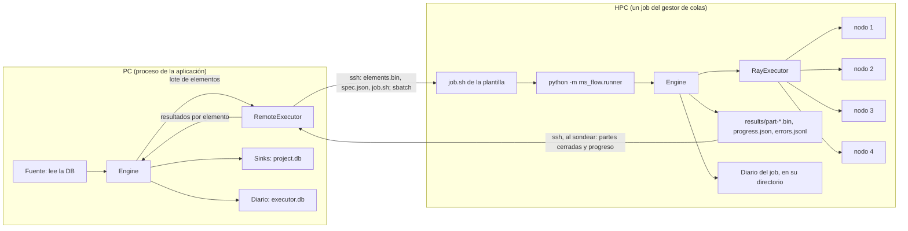

# 06 — Diseño del ejecutor remoto (HPC y Ray)

Estado: **propuesta, 2026-10-09**. Recoge lo que Mario explicó ese día y lo aterriza sobre el motor nuevo. Nada está construido. Las decisiones abiertas están al final; no se escribe código hasta cerrarlas.

## Lo que dijo Mario

- Hay dos tipos de trabajo en un HPC: el vergonzosamente paralelizable y el trabajo grande que pide muchos recursos para un solo cálculo. Casi todo lo nuestro es del primero.
- No se escribe otro motor de distribución: **dentro del job del HPC se usa Ray**. Se reservan, por ejemplo, 4 nodos de 20 CPUs; una plantilla de `sh` lanza un runner, que levanta el cluster de Ray sobre esos nodos igual que se levanta en las PC de una red, y lo alimenta.
- El runner es parte de `ms_flow`: se importa y se ejecuta dentro del script de bash del job. Lee un fichero con la lista de tareas individuales, no la base de datos.
- Tiene que dejar a la vista lo que va terminando, de forma que el sondeo desde la PC sepa el progreso, los fallos y los resultados parciales.
- Cada job del HPC es independiente, así que su configuración puede cambiar de uno a otro.
- Para el segundo tipo de trabajo, cuando haga falta, no se levanta Ray.
- En teoría es lo mismo que ejecutar en Ray sobre las PC de la red; cambia que en local `ms_flow` habla con el cliente de Ray directamente y en el HPC no.
- Por discutir: si el fichero lleva los payloads o si se generan al vuelo como en local.

## La idea

**El mismo motor en los dos lados, y ficheros entre ellos.** El runner del HPC no es un programa aparte con su lógica: es un `Engine` de `ms_flow` con un ejecutor de Ray, que lee los elementos de un fichero y escribe los resultados en ficheros. En la PC, el motor de siempre ve el HPC como un ejecutor más, cuyas tareas son jobs del gestor de colas.



Con esto no se reinventa nada: Ray reparte entre nodos; el `Engine` del runner pone lo que Ray no da y ya tenemos (clave por elemento, reintentos, diario para continuar un job que la cola mató, lotes de elementos cortos, coste por elemento); y la PC conserva sus reglas (la base de datos solo se toca en el proceso que lanza; un elemento está hecho cuando sus filas están escritas).

## Piezas

| Pieza | Dónde corre | Qué hace | Tamaño estimado |
|---|---|---|---|
| `RayExecutor` | PC o runner | El contrato de `executors.py` sobre `ray.remote`. Sirve tal cual para las PC de la red (`ray.init(address=...)` desde el escritorio) y dentro del runner | pequeño |
| `ms_flow.runner` | HPC | `python -m ms_flow.runner <dir>`: levanta o se une a Ray, crea el `Engine`, lee `elements.bin`, ejecuta, escribe partes de resultados, progreso y errores | pequeño |
| `Remote` | PC | Hablar con la máquina: ejecutar una orden y copiar ficheros. Primera versión: `ssh` y `rsync` del sistema | pequeño |
| Gestor de colas | PC | Tres órdenes: enviar, estado, cancelar. Slurm primero; `none` (un `nohup` por ssh) para una estación sin cola | pequeño |
| `RemoteExecutor` | PC | Junta elementos en un job del HPC, lo prepara y envía, sondea, trae partes y entrega cada elemento al motor | mediano |
| Ajustes | PC | Definición de cada ejecutor remoto: máquina, directorio, plantilla, recursos, lote, entorno | pequeño |

### Qué viaja y qué queda en el HPC

Un directorio por job del gestor de colas, bajo el directorio de trabajo configurado:

```
<workdir>/<clave del job>/<n>/
    spec.json        función ("módulo:nombre"), parámetros, recursos por elemento, versión de ms_flow
    elements.bin     los elementos de este job del HPC: clave + payload, uno tras otro
    files/           ficheros de entrada, copiados una vez aunque varios elementos los compartan
    job.sh           la plantilla rellenada
    results/         part-00001.bin, part-00002.bin...: (clave, resultado); una parte cerrada no cambia
    progress.json    {total, done, failed, running, fase, actualizado}
    errors.jsonl     clave, intento, traceback, entrada (el mismo repr corto del diario local)
    journal.db       el diario del Engine del runner
    runner.log       y la salida del gestor de colas
```

### El runner

1. Lee `spec.json` e importa la función por su nombre. La función tiene que existir en el entorno del HPC: paquete instalado, misma versión (lo comprueba y falla con un mensaje claro si no).
2. Ray, según `--ray`: `auto` levanta la cabeza en el primer nodo y un worker en cada uno de los demás con lo que diga la plantilla (`srun` en Slurm); `address` se une a uno que ya existe; `none` no usa Ray y corre con el pool de procesos en un nodo. Este último es también el camino del "otro tipo de trabajo": un job que es un solo cálculo grande no levanta cluster.
3. Crea el `Engine` con el diario en `journal.db` y la clave del job. Si la cola mata el job y se reenvía, continúa: no repite los elementos hechos.
4. Fuente: `elements.bin`, leído de uno en uno. Destino: una parte de resultados que se cierra cada N elementos o T segundos (renombrado atómico), para que desde fuera solo se vean partes completas.
5. Escribe `progress.json` cada pocos segundos y una línea en `errors.jsonl` por elemento que falla del todo.

### El ejecutor remoto, visto desde el motor de la PC

- Una "tarea" del ejecutor es un job del gestor de colas. `capacity` es cuántos jobs del HPC puede tener a la vez; el lote (cuántos elementos por job del HPC) sale de la configuración del ejecutor, que es la regla 2 de lotes del documento 05.
- No gasta tokens locales de CPU ni memoria.
- Sondea cada 30-60 s con **una** conexión para todos sus jobs: estado en la cola, `progress.json` y las partes nuevas. Cada elemento de una parte se entrega al motor en ese momento: el sink lo escribe en `project.db` y el diario local lo da por hecho. Los resultados parciales llegan mientras el job del HPC sigue corriendo.
- **Cerrar la aplicación no para el HPC.** El job local queda `interrupted`; al continuarlo (misma clave) el ejecutor encuentra sus directorios en el HPC, no reenvía nada y recoge lo que haya. Lo que ya estaba entregado no se repite, por la clave del elemento.
- Cancelar: `scancel` y se recoge lo terminado.

Esto pide **un cambio en el contrato de ejecutores**: hoy una tarea de varios elementos devuelve todos sus resultados al acabar. Hace falta que el ejecutor pueda dar por terminado cada elemento de una tarea cuando lo sabe, no al final. Es el único cambio en el `Engine`; el resto son piezas nuevas alrededor.

## Payloads en el fichero o generados al vuelo

Propuesta: **las dos cosas, cada una en su lado.**

- En la PC se generan al vuelo, como hoy: la fuente lee la base de datos de uno en uno y el motor pide por adelantado solo una ventana (lote × jobs simultáneos). Nunca se materializa el job entero ni se guarda en la base de datos, que fue lo que Mario probó y descartó.
- Lo que viaja a cada job del HPC es un fichero con **sus** elementos. Es transporte, no almacén: equivale a lo que en local se serializa hacia un worker, y se borra con el directorio del job.
- Para que ese fichero sea pequeño, la regla que ya existe: un elemento lleva datos planos y rutas. En cribado masivo el elemento es un shard (`.mshard` con ~1000 ligandos preparados), de modo que un job del HPC de un millón de ligandos son mil elementos y mil ficheros, no un millón de payloads.
- Generar en el HPC (mandar la función fuente y que itere allí) solo tiene sentido si la fuente no toca la base de datos, es decir, si lee ficheros. Con shards eso ya es el caso anterior. No se construye.

## Qué se ve en el monitor

Lo acordado en el documento 05 más lo propio del remoto: nombre del ejecutor, fase (`preparing`, `queued`, `running`, `collecting`), identificador en la cola, y el progreso contado en elementos hechos leídos al sondear. Los pasos `setup` (subir entradas, comprobar el entorno) se construyen aquí, con el primer ejecutor remoto, como estaba previsto.

## Entorno en el HPC

Primera versión: el usuario indica en los ajustes del ejecutor las líneas que activan el entorno (`module load`, `conda activate`), y un paso `setup` comprueba que `ms_flow`, el paquete de la aplicación y las herramientas están y en qué versión. Crear e instalar entornos remotos es de `ms_env`, aplazado.

## Orden de construcción

Cada paso se prueba solo y deja algo utilizable.

| Paso | Qué | Cómo se comprueba |
|---|---|---|
| R1 | Elementos de una tarea que terminan de uno en uno (contrato de ejecutores) | tests del motor; el banco no se mueve |
| R2 | `RayExecutor` | los tests de ejecutores, contra un Ray local; mismo job en `process` y en `ray` |
| R3 | `ms_flow.runner` con `--ray none` y con Ray local | un directorio de job preparado a mano, en la PC |
| R4 | `Remote` + gestor `none` + `RemoteExecutor` | de punta a punta contra `localhost` por ssh |
| R5 | Slurm, plantilla y `--ray auto` en varios nodos | en el cluster de verdad |
| R6 | Continuar tras cerrar la aplicación; `setup`; monitor | matar la aplicación con un job en cola y reabrir |

R1 a R4 no necesitan cluster. R5 necesita acceso a uno.

## Para el artículo

Usar Ray por dentro cambia cómo se cuenta: `ms_flow` no compite con Ray como planificador distribuido, lo usa. Lo que aporta encima es el diario y la continuación, los sinks, los tokens locales, la aplicación de escritorio que se cierra y vuelve, y una sola forma de escribir el job para la PC y el HPC. Las medidas externas quedan en dos: el coste de orquestar en local frente a joblib/loky, Dask y Ray local; y el coste de `ms_flow` sobre Ray frente a Ray solo.

## Decisiones abiertas

1. **¿Un job del HPC por job de `ms_flow`, o varios?** Propuesta: lo decide la configuración del ejecutor (elementos por job del HPC y cuántos a la vez); por defecto uno solo. Depende de los límites de tiempo y de cola del cluster.
2. **Transporte.** Propuesta: `ssh` y `rsync` del sistema, con las claves y el `~/.ssh/config` del usuario (una conexión persistente sirve también donde hay doble factor). Sin dependencia nueva. Alternativa: una biblioteca (`asyncssh`, `paramiko`).
3. **Datos del cluster**, que no conozco: gestor de colas (¿Slurm?), si el acceso pide doble factor, si los nodos de cómputo se ven entre sí por TCP (Ray lo necesita) y si tienen salida a internet, y si hay un sistema de ficheros compartido con la PC.
4. **Formato de `elements.bin` y de las partes.** Propuesta: pickle, como hacia un worker local; exige la misma versión mayor de Python y de los paquetes en los dos lados, y confiar en la cuenta propia del cluster.
5. **Cada cuánto se cierra una parte de resultados** (elementos o segundos) y cada cuánto se sondea. Propuesta: 30 s las dos, configurables por ejecutor.
6. **Quién levanta Ray en los nodos**: el runner (`--ray auto`, cómodo en Slurm) o la plantilla de `sh` (más adaptable a cada sitio). Propuesta: la plantilla manda; `auto` es lo que trae la plantilla de Slurm que se entrega.
7. **Payloads**: lo propuesto arriba (fichero por job del HPC, generado al vuelo en la PC).
