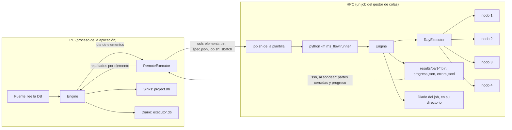

# 06 — Diseño del ejecutor remoto (HPC y Ray)

Estado: **diseño acordado, 2026-10-09**. Recoge lo que Mario explicó ese día y lo aterriza sobre el motor nuevo. Las decisiones están al final: tres las cerró Mario y cuatro quedan con el valor propuesto, que se puede cambiar sin rehacer nada. Se construye en el orden R1-R6.

## Lo que dijo Mario

- Hay dos tipos de trabajo en un HPC: el vergonzosamente paralelizable y el trabajo grande que pide muchos recursos para un solo cálculo. Casi todo lo nuestro es del primero.
- No se escribe otro motor de distribución: **dentro del job del HPC se usa Ray**. Se reservan, por ejemplo, 4 nodos de 20 CPUs; una plantilla de `sh` lanza un runner, que levanta el cluster de Ray sobre esos nodos igual que se levanta en las PC de una red, y lo alimenta.
- El runner es parte de `ms_flow`: se importa y se ejecuta dentro del script de bash del job. Lee un fichero con la lista de tareas individuales, no la base de datos.
- Tiene que dejar a la vista lo que va terminando, de forma que el sondeo desde la PC sepa el progreso, los fallos y los resultados parciales.
- Cada job del HPC es independiente, así que su configuración puede cambiar de uno a otro.
- Para el segundo tipo de trabajo, cuando haga falta, no se levanta Ray.
- En teoría es lo mismo que ejecutar en Ray sobre las PC de la red; cambia que en local `ms_flow` habla con el cliente de Ray directamente y en el HPC no.
- Por discutir: si el fichero lleva los payloads o si se generan al vuelo como en local.

Y al responder a las preguntas de este documento:

- **Cada cluster es distinto y hay que adaptarse a todos.** No se diseña para uno.
- La PC entra por `ssh` al **nodo de login**. Desde ahí pregunta al gestor de colas por el estado de los jobs y lee **ficheros de estado** para saber cómo avanza cada uno en tiempo real.
- **Nada de servicios en el HPC.** Se podría levantar un servidor, pero muchos clusters los bloquean, y más en el nodo de login.
- Que él sepa no hay doble factor. Los nodos de cómputo deberían verse entre sí, igual que hace falta para MPI. No hay disco compartido con la PC.
- Un job del HPC por job de `ms_flow` es lo normal, pero **no se limita**: el cluster deja encolar cientos y cada uno calcula cuando le toca en su cola.
- Transporte: usaba `paramiko` por ser fácil de configurar; deja la elección abierta.

## La idea

**El mismo motor en los dos lados, y ficheros entre ellos.** El runner del HPC no es un programa aparte con su lógica: es un `Engine` de `ms_flow` con un ejecutor de Ray, que lee los elementos de un fichero y escribe los resultados en ficheros. En la PC, el motor de siempre ve el HPC como un ejecutor más, cuyas tareas son jobs del gestor de colas.



Con esto no se reinventa nada: Ray reparte entre nodos; el `Engine` del runner pone lo que Ray no da y ya tenemos (clave por elemento, reintentos, diario para continuar un job que la cola mató, lotes de elementos cortos, coste por elemento); y la PC conserva sus reglas (la base de datos solo se toca en el proceso que lanza; un elemento está hecho cuando sus filas están escritas).

## Piezas

| Pieza | Dónde corre | Qué hace | Tamaño estimado |
|---|---|---|---|
| `RayExecutor` | PC o runner | El contrato de `executors.py` sobre `ray.remote`. Sirve tal cual para las PC de la red (`ray.init(address=...)` desde el escritorio) y dentro del runner | pequeño |
| `ms_flow.runner` | HPC | `python -m ms_flow.runner <dir>`: se une a Ray si hay, crea el `Engine`, lee `elements.bin`, ejecuta, escribe partes de resultados, progreso y errores | pequeño |
| `Remote` | PC | Hablar con el nodo de login: ejecutar una orden con entrada y salida. Los ficheros viajan como un `tar` por esa misma orden. `ssh` del sistema | pequeño |
| Gestor de colas | PC | Una entrada por gestor: las tres órdenes (enviar, estado, cancelar) y cómo leer su salida. Slurm primero; `none` (un `nohup` por ssh) para una estación sin cola | pequeño |
| `RemoteExecutor` | PC | Junta elementos en un job del HPC, lo prepara y envía, sondea, trae partes y entrega cada elemento al motor | mediano |
| Ajustes | PC | Definición de cada ejecutor remoto: máquina, directorio, plantilla, recursos, lote, entorno | pequeño |

### Qué viaja y qué queda en el HPC

Un directorio por job del gestor de colas, bajo el directorio de trabajo configurado:

```
<workdir>/<12 hex al azar>/
    fn.bin           la función, en pickle (puede ser un partial con los parámetros del job)
    spec.json        total, recursos por elemento, versión de Python, segundos por parte
    elements.bin     los payloads de este job del HPC, uno tras otro; el elemento es su posición
    job.sh           la plantilla rellenada
    results/         part-00001.bin, part-00002.bin...: (posición, resultado); una parte cerrada no cambia
    progress.json    {total, done, failed, running, status, error, at}
    errors.jsonl     {index, error} por elemento que falla del todo
    journal.db       el diario del Engine del runner
    runner.log       la salida del runner (con el gestor `none`; con Slurm, la que diga la plantilla)
```

Sin construir: `files/` (ficheros de entrada copiados una vez aunque varios elementos los compartan).

### El runner

1. Lee `spec.json` y carga la función de `fn.bin`. La función tiene que poder importarse en el entorno del HPC (paquete instalado); la versión de Python tiene que ser la misma que la de la PC, y si no lo es falla con un mensaje claro.
2. Ray, según `--ray`: una dirección se une al cluster que la plantilla ya levantó (la cabeza en el primer nodo y un worker en cada uno de los demás, con `srun` en Slurm); `none` no usa Ray y corre con el pool de procesos en un nodo. Este último es también el camino del "otro tipo de trabajo": un job que es un solo cálculo grande no levanta cluster.
3. Crea el `Engine` con el diario en `journal.db` y la clave del job. Si la cola mata el job y se reenvía, continúa: no repite los elementos hechos.
4. Fuente: `elements.bin`, leído de uno en uno. Destino: una parte de resultados que se cierra cada N elementos o T segundos (renombrado atómico), para que desde fuera solo se vean partes completas.
5. Escribe `progress.json` cada pocos segundos y una línea en `errors.jsonl` por elemento que falla del todo.

### El ejecutor remoto, visto desde el motor de la PC

- Una "tarea" del ejecutor es un job del gestor de colas. `capacity` es cuántos jobs del HPC puede tener a la vez; el lote (cuántos elementos por job del HPC) sale de la configuración del ejecutor, que es la regla 2 de lotes del documento 05.
- No gasta tokens locales de CPU ni memoria.
- Sondea cada 30-60 s con **una** conexión para todos sus jobs: estado en la cola, `progress.json` y las partes nuevas. Cada elemento de una parte se entrega al motor en ese momento: el sink lo escribe en `project.db` y el diario local lo da por hecho. Los resultados parciales llegan mientras el job del HPC sigue corriendo.
- **Cerrar la aplicación no para el HPC.** El job local queda `interrupted`; al continuarlo (misma clave) el ejecutor encuentra sus directorios en el HPC, no reenvía nada y recoge lo que haya. Lo que ya estaba entregado no se repite, por la clave del elemento.
- Cancelar: `scancel` y se recoge lo terminado.

Esto pide **un cambio en el contrato de ejecutores**: hoy una tarea de varios elementos devuelve todos sus resultados al acabar. Hace falta que el ejecutor pueda dar por terminado cada elemento de una tarea cuando lo sabe, no al final. Es el único cambio en el `Engine`; el resto son piezas nuevas alrededor.

### Adaptarse a cada cluster

Lo que cambia de un cluster a otro queda en tres sitios, y los tres son datos del ejecutor en los ajustes, no código:

| Qué cambia | Dónde se pone |
|---|---|
| Cómo se entra (usuario, salto por otra máquina, clave) | el `~/.ssh/config` del usuario; el ejecutor solo guarda el nombre de la máquina |
| El gestor de colas (Slurm, PBS, SGE, LSF) | una entrada con tres órdenes y la forma de leer el identificador y el estado. Se entrega la de Slurm; otra es añadir una entrada |
| Cómo se piden recursos, se activa el entorno y se levanta Ray | la plantilla de `job.sh`, que es un fichero de texto del usuario. Se entrega una para Slurm |

Un cluster cuyos nodos no se vean entre sí, o que no deje a Ray abrir sus puertos, no rompe el diseño: se usa `--ray none` con jobs de un nodo. Como no hay límite de jobs encolados, **muchos jobs de un nodo sin Ray** es una forma tan válida de repartir como un job de muchos nodos con Ray, y la más simple. Ray hace falta solo cuando se reserva más de un nodo por job.

### Sin servicios en el HPC

Nada queda escuchando. Ray, cuando se usa, vive dentro de la reserva del job, en los nodos de cómputo, y muere con él; nunca en el nodo de login. Todo lo que la PC sabe lo saca de una orden por `ssh` que termina:

- **Enviar**: una conexión. Por la entrada de la orden va un `tar` con `spec.json`, `elements.bin`, `job.sh` y los ficheros de entrada; la orden lo desempaqueta y llama al gestor de colas.
- **Sondear**: una conexión para todos los jobs del ejecutor. Devuelve el estado en la cola, cada `progress.json` y, en un `tar` por la salida, las partes de resultados cerradas que la PC aún no tiene.
- **Cancelar**: una conexión.

Con un sondeo cada 30 s son dos conexiones por minuto al nodo de login, hagan falta uno o cien jobs.

## Payloads en el fichero o generados al vuelo

Propuesta: **las dos cosas, cada una en su lado.**

- En la PC se generan al vuelo, como hoy: la fuente lee la base de datos de uno en uno y el motor pide por adelantado solo una ventana (lote × jobs simultáneos). Nunca se materializa el job entero ni se guarda en la base de datos, que fue lo que Mario probó y descartó.
- Lo que viaja a cada job del HPC es un fichero con **sus** elementos. Es transporte, no almacén: equivale a lo que en local se serializa hacia un worker, y se borra con el directorio del job.
- Para que ese fichero sea pequeño, la regla que ya existe: un elemento lleva datos planos y rutas. En cribado masivo el elemento es un shard (`.mshard` con ~1000 ligandos preparados), de modo que un job del HPC de un millón de ligandos son mil elementos y mil ficheros, no un millón de payloads.
- Generar en el HPC (mandar la función fuente y que itere allí) solo tiene sentido si la fuente no toca la base de datos, es decir, si lee ficheros. Con shards eso ya es el caso anterior. No se construye.

## Qué se ve en el monitor

Lo acordado en el documento 05 más lo propio del remoto: nombre del ejecutor, fase (`preparing`, `queued`, `running`, `collecting`), identificador en la cola, y el progreso contado en elementos hechos leídos al sondear. Los pasos `setup` (subir entradas, comprobar el entorno) se construyen aquí, con el primer ejecutor remoto, como estaba previsto.

## Entorno en el HPC

Primera versión: el usuario indica en los ajustes del ejecutor las líneas que activan el entorno (`module load`, `conda activate`), y un paso `setup` comprueba que `ms_flow`, el paquete de la aplicación y las herramientas están y en qué versión. Crear e instalar entornos remotos es de `ms_env`, aplazado.

## Quién hace de `process`

Decidido con Mario el 2026-10-09. Los jobs piden su ejecutor por nombre y casi todos piden `process`. Lo que cambia de una instalación a otra es **quién está registrado con ese nombre**, y es uno solo cada vez:

| Ajuste | Quién hace de `process` | Para qué |
|---|---|---|
| `process` (por defecto en una PC) | loky | la PC sola |
| `ray` + dirección | `RayExecutor` | la PC más las PC de la red (la PC es un nodo más), un cluster de Ray ajeno a la PC, o los nodos reservados de un HPC |
| `queue` + gestor + plantilla (+ máquina) | `RemoteExecutor` | con máquina, el HPC por `ssh`; sin máquina, la cola del HPC en el que ya se está |

- **Ray en local es una sustitución, nunca un segundo ejecutor.** Con loky y Ray a la vez en la misma PC habría dos contables de los mismos núcleos (el motor y Ray). Sustituyendo, solo cuenta Ray, que ya sabe qué tiene cada nodo, la PC incluida. Se descarta la reserva de recursos locales que se llegó a proponer.
- **Se cambia sin jobs activos.** El motor se niega a cambiar el ejecutor de un nombre mientras tenga tareas suyas.
- **Todo job vale con el ejecutor que haya.** Es la regla del documento 05 (un worker recibe datos y ficheros declarados, y devuelve filas): un job que la cumple corre igual en loky, en Ray o en una cola. No se construye la forma de fijar un job a un nodo. Lo que sí se exige es el mismo entorno (Python, paquetes, herramientas) en todos los nodos.
- `thread` sigue en local para lo ligero. Con Ray sustituyendo hay que darle lo que hoy solo tiene loky: límite de tiempo por elemento y progreso dentro de un elemento.

### `ms_flow` dentro del HPC

Quien abre una notebook en el HPC ya está "en local" allí: no hay `ssh` ni copia de ficheros, y el disco es compartido.

| Dónde se está | Quién hace de `process` | Estado |
|---|---|---|
| Nodo de login | `queue` sin máquina: `RemoteExecutor(host=None, scheduler="slurm")` | Construido (es el camino de los tests de R4); falta ejecutar la entrada de Slurm |
| Nodos reservados (`salloc`, o dentro de un job) | `ray` sobre esos nodos, con el disco compartido | `RayExecutor` existe; falta la receta que levanta Ray en los nodos, la misma de la plantilla de R5 |
| Un nodo de cómputo libre | `process` (loky) | Funciona; el motor tiene que contar los núcleos que dio la cola (`sched_getaffinity`) y no los del nodo |

**En un nodo de login no corre loky.** Se reconoce sin configurar nada en Slurm (existe `sbatch` y no hay `SLURM_JOB_ID`): ahí el workspace no registra loky y pide elegir `queue` o `ray`. Forzarlo es una opción explícita.

## Ficheros declarados

Una ruta en un elemento solo vale donde existe el fichero. AMDockVS ya lo declara (`core/worker_io.py`: `worker_file`, `worker_output_dir`); con el motor nuevo son dos marcas, las dos `str`, así que donde el disco es el mismo no hay nada que hacer y la task las usa como rutas:

| Marca | Qué declara | Donde el disco no es el mismo |
|---|---|---|
| `File(ruta)` | un fichero que la task lee | el ejecutor lo lleva, una vez aunque lo compartan muchos elementos, y la task recibe la ruta que tiene allí |
| `Dir(ruta)` | un directorio donde la task deja ficheros | la task recibe un directorio de allí; **vuelve a `ruta` lo que su resultado nombra** (un fichero, o un directorio entero), y esas rutas llegan cambiadas por las de aquí. Lo que deja y no nombra se queda allí y se borra |

| Ejecutor | Entradas (`File`) | Salidas (`Dir`) |
|---|---|---|
| loky, `thread` | la ruta tal cual | la ruta tal cual |
| Ray o cola con disco compartido (`shared=True`; por defecto en la cola sin máquina y en el Ray que arranca el propio ejecutor) | la ruta tal cual | la ruta tal cual |
| Ray sin disco compartido | los bytes van una vez al almacén de objetos; cada nodo los deja en un temporal la primera vez que los necesita | los bytes vuelven con el resultado |
| Cola por `ssh` | van en el `tar` del job, bajo `files/` | vuelven en el `tar` del sondeo, antes que los resultados que los nombran |

Solo los ejecutores que llevan ficheros recorren el elemento buscando marcas: el camino local no paga nada.

## Orden de construcción

Cada paso se prueba solo y deja algo utilizable.

| Paso | Qué | Cómo se comprueba |
|---|---|---|
| R1 | Elementos de una tarea que terminan de uno en uno (contrato de ejecutores) | tests del motor; el banco no se mueve |
| R2 | `RayExecutor` | los tests de ejecutores, contra un Ray local; mismo job en `process` y en `ray` |
| R3 | `ms_flow.runner` con `--ray none` y con Ray local | un directorio de job preparado a mano, en la PC |
| R4 | `Remote` + gestor `none` + `RemoteExecutor` | de punta a punta contra `localhost` por ssh |
| R5 | Slurm, y la plantilla que levanta Ray en varios nodos | en el cluster de verdad |
| R6 | Continuar tras cerrar la aplicación; `setup`; monitor | matar la aplicación con un job en cola y reabrir |

R1 a R4 no necesitan cluster. R5 necesita acceso a uno.

Añadido el 2026-10-09, antes de R6 y en este orden:

| Paso | Qué | Cómo se comprueba |
|---|---|---|
| F1 ✔ | Las marcas `File` y `Dir` | tests: en local son rutas |
| F2 ✔ | `File` en la cola por `ssh` y en el runner | test de R4 con un fichero que solo existe "aquí" |
| F3 ✔ | `File` en Ray sin disco compartido | Ray local con `shared=False`: la task lee una copia fuera de la carpeta de aquí |
| F4 ✔ | `Dir` en los dos | lo que la task deja aparece en la ruta de aquí |
| S1 ✔ | El ajuste de quién hace de `process`, el cambio sin jobs activos y el bloqueo de loky en el nodo de login | tests del workspace |
| S2 ✔ | Límite de tiempo y progreso por elemento en Ray | los tests que ya pasan con loky |

F1 a F4 están construidos (`engine/files.py`, `remote.py`, `runner.py`, `RayExecutor`; tests en `tests/test_files.py` y `tests/test_remote.py`), con estos techos, anotados en el código:

- **Qué hay en memoria a la vez.** El motor entrega a un ejecutor tantas tareas como su `capacity` (en Ray, los núcleos del cluster) y lee por delante el doble; nunca el job entero. En Ray un fichero está en el almacén de objetos mientras alguna tarea en vuelo lo lee, y se suelta con la última: con 5 000 receptores viven los de las tareas que están corriendo. La copia de cada nodo en su temporal sí se queda hasta que lo limpie el sistema (disco, no memoria).
- En la cola el job sale de un `tar` en disco, del tamaño que sea. Vuelven en memoria el `tar` de cada sondeo y, en Ray, los bytes de lo que un resultado nombra: lo producido por las tareas de un sondeo o de una tarea, no más.
- En la cola un job de `ms_flow` es un job del HPC con **todos** sus elementos, salvo que `elements_per_job` diga otra cosa: ahí sí se materializa el job entero en la PC antes de enviarlo.
- Las marcas se buscan en diccionarios, listas y tuplas del elemento; dentro de otros objetos no se miran.
- Sin cluster, "otro disco" se ha probado como otra carpeta de esta máquina.

S1 está construido (`tests/test_process_role.py`):

- El ajuste es `resources.process`: `kind` (`process` \| `ray` \| `queue`), `on_login_node`, y dentro `ray` (`address`, `shared_disk`) y `queue` (`host`, `scheduler`, `workdir`, `python`, `setup`, `runner`, `template`, `elements_per_job`, `max_jobs`, `poll_seconds`, `shared_disk`).
- El workspace lo lee al construir el motor. Tras cambiarlo se llama a `ms.reload_executors()`, que falla con `ValueError` mientras un job de `process` no haya terminado. En el motor es `Engine.unregister(nombre)`, y `register` sobre un nombre ocupado sustituye con la misma regla.
- En un nodo de login (`sbatch` en el `PATH` y sin `SLURM_JOB_ID`) no se registra `process`; `ms.submit` lo dice y nombra los dos ajustes. `thread` sigue disponible.
- El motor, el runner y los ajustes cuentan los núcleos con `sched_getaffinity`: dentro de un job de la cola son los que dio la cola.
- Sin construir: que la interfaz de ajustes llame a `reload_executors()` al guardar. Y un resto que estorba aquí: `_HARDCODED_LOCAL_CPU_LIMIT = 14` en los ajustes limita `resources.local.cpus` a 14 en cualquier máquina.

S2 está construido (en `test_the_same_jobs_on_ray`):

- **Límite de tiempo**: `kill()` cancela a la fuerza todo lo que Ray tiene del ejecutor, que es lo que el motor pide a cualquier ejecutor; el elemento que se pasó falla con "timed out" y los demás vuelven a la cola sin cargo. El límite cuenta desde que Ray recibe la tarea: si los elementos piden más núcleos de los que Ray tiene libres, parte del límite se va esperando en Ray.
- **Progreso**: lo que la task dice con `report()` va, como mucho dos veces por segundo, a un actor del ejecutor; `progress()` responde con lo último que trajo y pide lo nuevo, así que va una consulta por detrás.

## R6: continuar tras cerrar la aplicación (propuesta, sin construir)

Hoy cerrar cancela el job de la cola. Mientras no exista lo de abajo es lo correcto: dejarlo correr sin poder recogerlo serían horas de HPC perdidas.

**Qué cambia**

1. **El motor distingue interrumpir de cancelar.** Un ejecutor dice que sus tareas viven fuera de este proceso (`outlives = True`). Al interrumpir un job (cerrar la aplicación o el proyecto) el motor no cancela las tareas de ese ejecutor; al cancelarlo, sí.
2. **El ejecutor recibe la clave del job** (la del diario, `key=`), igual que ya recibe el coste.
3. **El registro vive en la otra máquina, no en la PC.** El directorio de un job de la cola se llama `<clave del job>-<n>` y guarda, además de lo de ahora, la clave de contenido de cada elemento en orden y el identificador de la cola. No hay fichero local que perder ni que sincronizar, y se puede continuar desde otra PC. Cuesta una orden más al primer envío de cada clave.
4. **Continuar es reenviar el job con la misma clave**, que es como ya continúa cualquier job. El motor entrega los elementos que el diario no da por hechos; el ejecutor mira qué directorios hay de esa clave y cada elemento que ya está en uno **no se envía**: su resultado se espera de ahí. Lo que terminó con la aplicación cerrada llega en el primer sondeo. Los elementos que no están en ninguno van en un job nuevo.
5. Para eso `RemoteExecutor` separa lo que hoy es una sola cosa: el job de la cola (lo que se sondea) y la tarea del motor (lo que se responde), unidos elemento a elemento. Al reabrir, los paquetes del motor no coinciden con los de antes.
6. Un job sin clave no tiene con qué continuar: al cerrar se cancela, como hoy.

**Lo que hay que decidir**

| | Pregunta | Propuesta |
|---|---|---|
| A | ¿Quién reenvía al reabrir? Hoy tiene que hacerlo la aplicación, que entonces debe guardar con qué parámetros lanzó cada job | Que lo guarde `ms_flow`: el diario apunta el job y sus parámetros, `ms.resume(clave)` lo vuelve a lanzar y el monitor ofrece "Continuar" en un job interrumpido. Sirve igual para loky |
| B | ¿Qué hace cerrar con jobs en la cola? | Siguen corriendo. Cancelar es siempre un gesto explícito |
| C | ¿Y lo que nunca se reabre? Quedan directorios y horas de HPC | `ms.remote_jobs()`: lo que hay en la otra máquina de este usuario, con cancelar y borrar; el monitor lo enseña aunque el proyecto no esté abierto |

`setup`, los campos del monitor y el log por job salen de R6 y van después, cada uno por su lado.

### Estado (2026-10-09)

R1 a R4 están construidos, cada uno en su rama local, con sus tests:

| Paso | Dónde | Qué quedó distinto del diseño |
|---|---|---|
| R1 | `engine.py`, contrato en `executors.py` (`bind_parts`) | Nada. Además un ejecutor puede pedir el coste declarado del job (`wants_cost`) y decir cuántos elementos quiere por tarea (`batch`, la regla 2 de lotes) |
| R2 | `RayExecutor` en `executors.py` | Límite de tiempo y progreso dentro de un elemento llegaron con S2 |
| R3 | `ms_flow/runner.py` (`stage` y `python -m ms_flow.runner <dir> [--ray DIRECCIÓN] [--cpus N]`) | La función viaja en pickle (`fn.bin`), no por nombre. Sin `--ray` usa el pool de procesos. Probado con pool, con un Ray local (`--ray auto`), con `SIGTERM` y con `SIGKILL`; tras un `SIGKILL` un elemento puede salir dos veces en las partes y quien lee ignora la repetición |
| R4 | `ms_flow/remote.py` (`Remote`, `SCHEDULERS`, `JOB_SH`, `RemoteExecutor`) | **Probado contra esta máquina con `sh`, no por `ssh`**: `Remote(host=None)` ejecuta las mismas órdenes en local. El camino `ssh` es el mismo código con otro `argv`, y no se ha ejecutado: en la PC de desarrollo `ssh localhost` no entra por clave. La entrada de Slurm está escrita del manual y sin ejecutar |

Cómo se comporta lo construido:

- Un hilo del ejecutor habla con la otra máquina; el motor nunca espera por ella. Enviar es una orden (`mkdir`, `tar xf -`, la del gestor); sondear es otra para todos los jobs (quién sigue en la cola y un `tar` con el progreso, los errores y las partes nuevas).
- Un job que sale de la cola sin haber terminado y **más lejos de donde estaba** al enviarlo (se le acabó el tiempo) se envía otra vez sobre el mismo directorio y el runner continúa. Si sale sin haber avanzado, el job falla con lo que dijo el runner y su directorio se queda en la otra máquina para mirarlo.
- Lo que termina bien no deja nada en la otra máquina. Cancelar para el job en la cola y borra su directorio. **Cerrar la aplicación o el proyecto también lo cancela y lo borra** (medido el 2026-10-09; aquí ponía lo contrario): al interrumpir un job el motor cancela lo que tiene en vuelo, en cualquier ejecutor. Que siga corriendo es R6.
- Un elemento que falla y se reintenta desde la PC va en un job del HPC propio. Los reintentos dentro del mismo job del HPC no están: `stage` los admite, el ejecutor no los pasa.

Falta, además de R5 y R6: el log por job. Los ficheros de entrada y el registro desde los ajustes llegaron con F1-F4 y S1.

## Para el artículo

Usar Ray por dentro cambia cómo se cuenta: `ms_flow` no compite con Ray como planificador distribuido, lo usa. Lo que aporta encima es el diario y la continuación, los sinks, los tokens locales, la aplicación de escritorio que se cierra y vuelve, y una sola forma de escribir el job para la PC y el HPC. Las medidas externas quedan en dos: el coste de orquestar en local frente a joblib/loky, Dask y Ray local; y el coste de `ms_flow` sobre Ray frente a Ray solo.

## Decisiones

Cerradas por Mario (2026-10-09):

1. **Jobs del HPC por job de `ms_flow`.** Por defecto uno. Dos ajustes del ejecutor lo cambian: cuántos elementos lleva cada job del HPC (por defecto, todos) y cuántos jobs puede tener a la vez en la cola (por defecto, **sin límite**).
2. **Transporte: `ssh` del sistema**, y nada más. Usa las claves, el agente y el `~/.ssh/config` que el usuario ya tiene, saltos incluidos; no añade dependencias; existe en Linux, macOS y Windows 10 en adelante. Los ficheros van como `tar` por la misma conexión (`tarfile` en la PC, `tar` en el HPC), así que no hace falta `rsync` ni `scp`. Pide acceso por clave: sin terminal no se puede escribir una contraseña, y el ejecutor lo dice claro si la máquina la pide. Un cluster que solo admita contraseña sería el motivo para añadir `paramiko`; `Remote` son dos funciones, se cambia ahí.
3. **El cluster.** No se asume ninguno: entrada por `ssh` al nodo de login, sondeo con órdenes del gestor de colas y ficheros de estado, ningún servicio, ningún disco compartido con la PC. Que los nodos se vean entre sí se comprueba al levantar Ray; si no, jobs de un nodo.

Tomadas con el valor propuesto, a falta de que Mario diga otra cosa:

4. **Formato de `elements.bin` y de las partes: pickle**, como hacia un worker local. `spec.json` lleva la versión de Python y el runner se niega a arrancar si no coincide; la de `ms_flow` no se comprueba todavía.
5. **Cadencia: 30 s** para cerrar una parte de resultados y para sondear, configurables por ejecutor.
6. **Ray lo levanta la plantilla**, no el runner. La de Slurm que se entrega lo hace con `srun`; el runner recibe la dirección o `--ray none`.
7. **Payloads**: un fichero de elementos por job del HPC, generado al vuelo en la PC y borrado con su directorio.
