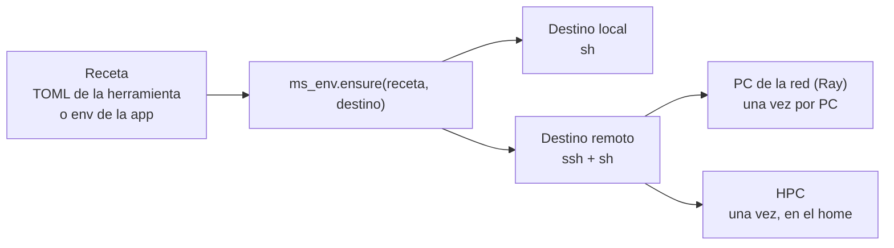

# 07 — Diseño de `ms_env`

Estado: **aprobado por Mario, 2026-10-09**. Nada construido. Se empieza por E1 cuando exista el repo.

## Lo que dijo Mario

- `ms_env` es importante y es un paquete propio. Hace dos cosas: crea los env donde corren los programas que no son compatibles con el nuestro o piden aislamiento, y **replica el env en el remoto**.
- También es responsable de **comprobar e instalar en el remoto la misma versión de la app** (AMDockVS) que corre en la PC. Lo que se ejecute allí tiene que ser lo mismo que hay aquí.
- **Un solo env por host, que se actualiza**, y no un env por versión: es más fácil y más limpio. Si el mismo usuario usa dos versiones distintas de la app contra el mismo host, no se cubre.
- El env es **por host**. En una red local con Ray se crea en cada PC, en teoría igual al que se está ejecutando. En un HPC se instala una vez en el home, que el sistema exporta a los nodos; se activa en el fichero del job. En nodos reservados cree que pasa lo mismo, sin haberlo comprobado.
- Internet en el destino: sí en el HPC. En PC de la red local no lo tiene claro, y pregunta si hay forma de replicar el env de forma íntegra, sabiendo que las versiones del sistema operativo pueden ser distintas.
- `ms_flow` puede depender de `ms_env`, con el acceso `ssh` ahí.
- Solo Linux. Windows queda fuera.

## Lo que ya hay

La mitad está escrita dentro de `ms_flow`, en lo único que sobrevivió del motor viejo en `core/executor/`.

| Qué | Dónde | Estado |
|---|---|---|
| Receta TOML por herramienta (`[tool]`, `[locate]`, `[env]`, `[[install]]`) | `core/executor/tools.py` | En uso: AMDockVS tiene 4 (openbabel, pkasso, qvina, adgpu) |
| Buscar una instalación que funcione: rutas del usuario, prefijo gestionado, `PATH` | `tools.locate` | En uso |
| Crear un prefijo conda; descarga micromamba si no hay gestor | `tools._env_steps` | En uso |
| Instalar en un hilo de la app, sin proyecto abierto | `tools.install_tool` | En uso |
| Esperar por una herramienta: `tool:<nombre>@<destino>` en `depends_on` | `tools.dependency_state` | **Muerto**: lo leía el alimentador del motor viejo |
| Pasos con log línea a línea | `provisioning.Step`, `run_step`, `run_steps` | En uso (diálogo de pasos de ms_components, AMDockVS) |
| Probar un worker | `provisioning.test_steps` | En uso (editor de workers de ms_components) |
| YAML de `ray up`, `prepare_steps`, `conda_bootstrap_command`, `in_env`, `probe_tcp`, `ray_preflight`, `prefix_python`, `prefix_command` | `provisioning.py` | **Sin llamadas** fuera del propio fichero |
| `ssh` | `provisioning.ssh_argv` y `remote.Remote` | Dos implementaciones |
| Env del otro lado para el runner | `resources.process.queue.python` y `.setup` | **A mano**: nadie lo crea; el runner solo exige la misma versión menor de Python |

## La idea

Una **receta** dice cómo saber si algo funciona y cómo instalarlo. Un **destino** es dónde: esta máquina o un host al que se entra por `ssh`. `ms_env` aplica una receta a un destino.

Replicar no es copiar: es **aplicar la misma receta en otro destino**. Es lo que `tools.py` ya hace con las herramientas; lo nuevo es una receta para el env de la app.

`ms_env` es la capa más baja: solo biblioteca estándar, sin Qt y sin importar `ms_flow`. `ms_flow` lo importa para su ejecutor remoto; las apps, para sus herramientas.

## Piezas

- **Destino.** `Target(host=None)`: `run(orden, datos)` y el envío y la recogida de ficheros como flujos `tar`. Sale de `remote.Remote`, y `provisioning.ssh_argv` desaparece. Las reglas no cambian: el `ssh` del sistema con `BatchMode=yes`, solo llaves, ninguna credencial gestionada, nada escuchando del otro lado.
- **Receta.** El formato TOML de hoy, sin cambios.
- **Tres verbos.** `status(receta, destino)`, `ensure(receta, destino)` (no hace nada si ya está) y `remove(receta, destino)`. Más `installed(destino)` para listar lo que hay.
- **Sello.** Cada prefijo instalado lleva un fichero con lo que se instaló (nombre, versión, hash de la receta). `status` lo lee con una sola orden; es lo que permite decir «está al día» sin volver a resolver nada.
- **Cerrojo.** Un `mkdir` en el destino mientras dura una instalación, para que dos apps o dos PC no instalen a la vez en el mismo prefijo.

## El env de la app en el remoto

Lo que corre allí es `python -m ms_flow.runner`, que importa las funciones de la app. No hace falta un runner de la app: hace falta que la app esté instalada allí **en la misma versión**.

- **Uno por host**, en un prefijo fijo (`{envs_home}/{app}`), que se actualiza en sitio.
- **Igual al de la PC.** La receta se deriva del env que está corriendo: la versión menor de Python y un fichero de restricciones con `nombre==versión` de todo lo instalado aquí (`importlib.metadata`). En el destino: `pip install {app}=={versión} -c restricciones.txt`. Mismas versiones de todo sin copiar bytes, así que da igual que el sistema operativo sea otro.
- **Comprobación al conectar.** El sello del destino contra el hash de la receta local. Igual: adelante. Distinto: se actualiza.
- **No se actualiza con jobs vivos.** Un job con clave sigue en la cola del HPC con la app cerrada (R6). Si el env cambia debajo, ese job arranca con otro código que el que lo preparó. Regla: si la cuenta tiene jobs vivos en ese host (`ms.remote_jobs()` lo sabe), no se actualiza y se dice por qué. Es la misma regla que ya vale para los ejecutores: solo cambian sin jobs activos.
- **En desarrollo** la versión no distingue nada (el código cambia sin cambiar de número). El código local viaja como wheel construido de la fuente, y el sello lleva su hash.
- El ejecutor remoto recibe `env=` y rellena él `@python@` y `@setup@`; escribirlos a mano sigue siendo posible.

### Por host

| Dónde | Cuántas veces | Quién activa |
|---|---|---|
| PC de la red local (Ray) | Una por PC | El arranque del worker de Ray en esa PC |
| HPC | Una, en el home de la cuenta | La plantilla del job (`@setup@`) |
| Nodos reservados dentro de un job | Ninguna más: ven el mismo home | La plantilla, al lanzar Ray en cada nodo |

Lo de los nodos reservados es lo habitual (home compartido, y Slurm pasa el entorno a `srun`), pero se comprueba en el cluster de Mario (R5), no se da por hecho.

### Sin internet en el destino

La receta necesita que el destino llegue a conda-forge y a PyPI. Para un host que no llega hay una segunda forma de `ensure`, **empaquetar**: el env se empaqueta en la PC (`conda-pack`), viaja por el mismo `ssh` como `tar` y se desempaqueta allí.

- Funciona entre distribuciones de Linux distintas: los paquetes de conda-forge traen sus bibliotecas y solo piden una glibc antigua.
- No funciona entre arquitecturas (x86-64 a ARM) ni lleva los drivers de la GPU.
- Son varios GB por host, una vez por versión.

Se construye cuando aparezca el primer host sin internet, no antes.

## Qué se mueve y qué se borra

| De `ms_flow` | Destino |
|---|---|
| `core/executor/tools.py` | `ms_env`, menos `tool_dependency` / `dependency_state` |
| `provisioning.Step`, `run_step`, `run_steps`, `find_environment_manager` | `ms_env` |
| `remote.Remote` | `ms_env.Target`; `remote.py` lo importa |
| `provisioning.test_steps` | Se queda en `ms_flow` (prueba workers, no envs) hasta que el editor de workers se rehaga |
| El resto de `provisioning.py` | Se borra |

`core/executor/` desaparece de `ms_flow`. ms_components y AMDockVS cambian sus imports.

## Fases

Una rama local por fase.

| Fase | Qué | Cómo se sabe que está |
|---|---|---|
| E1 | Repo `ms_env`: destino, recetas, `status` / `ensure` / `remove`. Mover, no reescribir. Borrar lo muerto | Las 4 recetas de AMDockVS instalan igual que hoy; la suite de `ms_flow` pasa |
| E2 | Sello, cerrojo, `installed(destino)` | Un segundo `ensure` no hace nada; dos a la vez no se pisan |
| E3 | Env de la app: receta derivada del env local, wheel en desarrollo, `env=` en el ejecutor remoto, regla de jobs vivos | Un job remoto contra el laptop de Mario sin preparar nada a mano |
| E4 | Espera en el motor: un job dice qué herramientas necesita y no arranca hasta que están en el destino | Sustituye a `tool:<nombre>@<destino>` |
| E5 | UI en ms_components: envs y herramientas por destino | — |
| Después | Empaquetar (sin internet), contenedores, Windows | — |

E1 a E3 se prueban con el laptop de Mario como destino `ssh` real: es la primera vez que ese camino corre de verdad, porque hasta ahora solo se probó con `Remote(host=None)`.

## Decisiones

Cerradas por Mario (2026-10-09):

- Paquete propio, `ms_env`, en su repo; quinto paquete en PyPI. `ms_flow` depende de él; el `ssh` vive en `ms_env`.
- Un env de la app por host, actualizado en sitio. Dos versiones de la app contra el mismo host no se cubren.
- El env es por host: cada PC en una red local, una vez en el home en un HPC.
- «Igual» son las mismas versiones de todo, no los mismos bytes (fichero de restricciones).
- Sin internet: empaquetar, cuando aparezca el primer host que lo pida.
- El env remoto lleva la app entera, Qt incluido. No se parten las dependencias de la app: la UI no estorba allí y partirlas lo complica todo.
- Con jobs vivos de la cuenta en ese host, el env no se actualiza.
- Solo Linux.

Abiertas: ninguna. Lo de los nodos reservados se comprueba en el cluster (R5).
