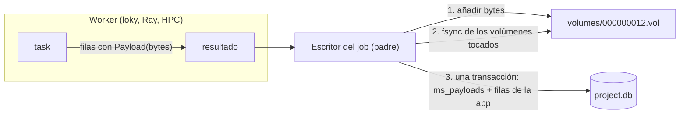
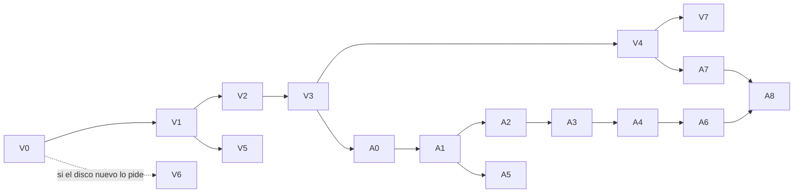

# 08 — Plan: volúmenes para los payloads por entidad

Estado: **aprobado por Mario, 2026-10-16. V0 hecho salvo V0-4 (rama `feat/payload-volumes`).** La dirección se acordó el 2026-10-15, después de los bancos de pruebas. Va primero en `ms_flow` (hitos V0-V7) y, cuando esté, en AMDockVS (hitos A0-A8). Cada tarea sigue la regla del README: una rama, un PR y su medida.

## Lo que dijo Mario

- Los ficheros sueltos por molécula y la bifurcación VS/HTPVS hacen que el almacenamiento sea confuso y gaste inodos. Se comparó lo de Ringtail (todo en SQLite) con un índice SQLite más contenedores.
- **Hasta unos 100M de moléculas: una fila por molécula y sus payloads en volúmenes.** Si se llega ahí, «más que feliz». Mario espera que muy pocos usuarios lleguen, porque el disco pesa.
- **Más allá: los `.mshard` tal como están hoy**, para el volumen alto, y se materializa en filas y volúmenes solo lo que de verdad se usa.
- Los volúmenes son infraestructura de `ms_flow`, junto a `core/data/shard.py`. AMDockVS (y en el futuro péptidos, proteínas, ácidos nucleicos, anticuerpos, DrugCLIP, SPRINT, generación de compuestos) los usa a través de la API.
- **No hay migración**: se empieza de cero. **Una API de exportación es obligatoria**, porque las rutas de hoy no sirven al usuario.
- Preocupaciones que hay que cubrir: escribir con tantos escritores como se usen, un worker que lee mientras otro escribe, el código de compactación, no cargar volúmenes enteros en RAM, y cómo encaja «cada worker con su volumen» con loky, Ray en la red local y el HPC (con su doble modo: Ray interno sobre los nodos asignados, o un solo programa que gestiona los recursos).
- Reorganizar los volúmenes (por puntuación o por cluster) más adelante, para probar.
- Mario los llama «vshards». Ver D1.

## Lo que se midió (2026-10-15)

Payloads sintéticos con tamaños de AMDockVS: original 2 KB, preparado 3 KB, PDBQT 2,5 KB y pose de 20 KB en el 20 % de las moléculas, lo que da unos 13 KB por molécula. Disco XPG S40G al 95 % de ocupación: escribe a 43 MB/s directo (`dd`) y lee a 781 MB/s. Los tiempos absolutos están limitados por ese disco; las proporciones entre variantes son lo que vale. Informe: `AMDockVS/docs/storage_benchmark_2026-10-15.html`. Scripts: `/tmp/bench_store_script/bench2.py` y `bench3.py`; los resultados están en `results_700k.jsonl` y `results_par.jsonl` (V0-1 los trae al repo).

**Un escritor, 700k moléculas:**

| Variante | Importar | Tamaño | Traer molécula X (p50) | Leer todo |
|---|---|---|---|---|
| Volúmenes, sin fsync | 143,9 s | 9,1 GB | 26 µs | 36,5 s |
| Volúmenes, fsync por shard | 274,8 s | 9,1 GB | 25 µs | 32,5 s |
| SQLite blobs, `synchronous=OFF` | 203,8 s | 11,5 GB | 45 µs | 48,7 s |
| SQLite blobs, por defecto (Ringtail) | 427,4 s | 11,5 GB | 45 µs | 38,3 s |

**14 escritores (loky, `cpus=-2`), 700k moléculas:**

| Variante | Importar | Ficheros | Tamaño | RSS máx. |
|---|---|---|---|---|
| Volúmenes, escribe el padre | 134 s | 35 | 9,0 GB | 0,5 GB |
| Volúmenes, uno por worker | 136 s | 43 | 9,0 GB | 0,1 GB |
| Volúmenes, un segmento por chunk | 142 s | 701 | 9,0 GB | 0,1 GB |
| RocksDB BlobDB (rocksdict) | 240 s | 137 | 9,1 GB | 0,8 GB |
| LMDB | 314 s | 3 | 11,8 GB | 10,9 GB |
| SQLite blobs | 423 s | 1 | 11,5 GB | 0,7 GB |

Conclusiones que fijan el diseño:

1. **Las tres formas de escribir en volúmenes empatan.** En este disco el límite es el disco, no el escritor, así que el padre escribiendo solo alcanza. Hacer que el worker escriba (V6) queda pendiente de medir en el disco nuevo de 7000 MB/s.
2. **LMDB y RocksDB quedan descartados.** Son más lentos, solo admiten un escritor, el fichero de LMDB nunca se encoge y su mmap aparece como RSS. Lo mismo Parquet+DuckDB, que no hace falta si los `.mshard` cubren lo que pasa de 100M.
3. **Las lecturas en paralelo de esa corrida no valen.** SQLite quedó entero en la caché de páginas y los volúmenes se leyeron del disco. V0-2 las repite con la caché vaciada.

**Tamaño real** (librería de 33M de Mario): SDF 93,9 GB (unos 2,8 KB por molécula, con propiedades que sobran), `.gz` 7,0 GB, SMILES 2,3 GB. Los 13 KB del banco son 3-4 copias por molécula. Con zstd y diccionario por tipo de payload (V5), y sin guardar copias que se pueden derivar, 100M preparadas deberían caber en unos 30-60 GB más las poses.

## Lo que ya hay

| Qué | Dónde | Qué se hace con ello |
|---|---|---|
| Contenedor `.mshard`: rango de ids, fsync + `os.replace`, BLAKE2b, `kind`/`serializer`/`codec` u16 | `core/data/shard.py` | Se queda igual. Los volúmenes van al lado y reutilizan la idea de `codec` |
| `File` y `Dir`: marcas de ruta en un elemento | `engine/files.py` | `File` lleva al nodo el receptor materializado una vez por job. `Dir` es el mecanismo de V6 |
| Lo que un resultado nombra bajo un `Dir` vuelve con él | `engine/executors.py` (`_apply_far`, `RayExecutor._finished`), `remote.py` (`RemoteExecutor._bring`) | V6 lo usa tal cual |
| Escritor de un job: `_Table.write(results)`, una transacción por grupo, elemento hecho cuando sus filas están | `engine/flow.py` | V2 convierte ahí los `Payload` |
| `persist_output_spec` / `insert_graph` | `core/database/project.py` | V2: las filas de `ms_payloads` entran en la misma transacción |
| Tablas de `ms_flow` en `project.db` (`project_artifacts`...) | `core/database/project_models.py` | Ahí van `ms_volumes` y `ms_payloads` |
| `project.db`: WAL, `synchronous=NORMAL`, `busy_timeout=30000` | `core/database/base.py` | Fija la regla de durabilidad (I1) |

En AMDockVS (`src/amdockvs`), las columnas con rutas y cuántas veces aparecen (ficheros / usos):

| Columna | Tabla | Ficheros | Usos |
|---|---|---|---|
| `stored_path`, `current_path` | `molecules` | 34 / 34 | 112 / 117 |
| `file_path` | `molecule_models` | 22 | 128 |
| `pose_path` | `docking_results` | 20 | 89 |
| `reference_receptor_path`, `reference_ligand_path` | `complexes` | 14 / 13 | 45 / 43 |
| `crystal_pose_path` | `sets` | 2 | 4 |
| `result_path` | `screening_shard_runs` | 6 | 25 |
| `"prepared": ruta` por motor, dentro de `metadata` JSON | `molecules` | `docking/preparation/state.py` | — |

Además:

- `molecules/storage.py`: `DbStore` (VS) y `ShardStore` (HTPVS).
- `docking/shard_tasks.py:116`: un `TemporaryDirectory` con `extract_ligands` para los ligandos de un shard.
- `docking/engines/vina.py:480`: `set_ligand_from_file`.
- `project/deletion.py`: `delete_results_where`, `remove_unreferenced_files`.
- `screening/materialize.py`: `ingest_hits` escribe con una sesión, no con un sink.

Las columnas `model_path` (QSAR) y `snapshot_path` (clustering, parquet) son ficheros por ejecución, no por entidad: se quedan como ficheros (D4).

## La idea

Tres niveles, según cómo se accede a los datos:

| Nivel | Qué | Cómo se accede |
|---|---|---|
| Filas (SQLite) | Una por entidad: propiedades, puntuaciones, estado, referencias | Filtrar, ordenar, contar |
| Volúmenes | Los bytes de cada entidad: SDF, PDBQT, poses, PDB de receptores | Por id, en lote ordenado por ubicación |
| Ficheros de arrays | Huellas, embeddings, índices ANN, snapshots | Enteros y vectorizados (ya existe: `.npy`, parquet) |

Un volumen es un fichero al que solo se le añade al final. Una fila de `ms_payloads` dice dónde están los bytes de un payload: volumen, offset y longitud. Las tablas de la app guardan el **id** del payload, nunca la ubicación. Así compactar solo reescribe `ms_payloads` y nunca las tablas de la app. Es el patrón de Haystack, SeaweedFS, Bitcask y el BlobDB de RocksDB.



### Por ejecutor

| Ejecutor | Disco del proyecto | Cómo llegan los bytes al padre |
|---|---|---|
| Pool local (loky) e hilos | Compartido | En el resultado, como hoy (V2). Con V6, un segmento en un `Dir` |
| Ray, en esta máquina o con disco compartido | Compartido | Igual |
| Ray en las PC de la red (`shared=False`) | No | En el resultado, por el object store. Con V6, el segmento vuelve por `_apply_far` |
| HPC con `RemoteExecutor` | No | En `results/part-*.bin` del job. Con V6, el segmento en `out/`, traído por `_bring` |
| Dentro del HPC: Ray en los nodos asignados | Compartido entre nodos, no con la PC | Lo mismo que el HPC: el runner escribe ficheros y el padre los lee |
| Dentro del HPC: un solo programa (por ejemplo un modelo de IA) | Igual | Un solo escritor, el mismo contrato |

**Ningún proceso remoto escribe en el proyecto.** Un volumen persistente por worker (la variante VW del banco) solo funciona con disco compartido y no se construye: el contrato es el mismo en todas partes.

Para leer, la fuente del job pone los bytes en el elemento, leídos en lote y en orden de ubicación. Funciona igual en todos los ejecutores. Lo grande y compartido (un receptor) se materializa una vez por job y viaja como `File`, que los ejecutores ya llevan una sola vez.

## Formato

```
<proyecto>/
    project.db
    volumes/
        000000001.vol      sellado
        000000002.vol      activo (lo escribe un solo escritor)
        staging/           segmentos de tasks pendientes de adoptar (V6)
        dicts/             diccionarios zstd (V5)
```

**Volumen.** Una cabecera de 32 bytes: `MSVOL`, versión, id del volumen y serie. Después, agujas una tras otra. Cada aguja lleva una cabecera de 16 bytes, `<IIIHH`: crc32 de los bytes guardados, longitud guardada, longitud original, codec y flags. Después van los bytes. La cabecera de cada aguja sirve para comprobar (I7) y para que `check` recorra un volumen sin la base de datos.

**Tablas (`ms_flow`, en `project.db`):**

```
ms_volumes   id PK, series TEXT, state TEXT (active|sealed|trash), size INT, created_at
ms_payloads  id PK, volume_id → ms_volumes.id (índice), offset INT, length INT,
             raw_length INT, codec INT, crc32 INT, kind TEXT
```

**Referencias desde la app:** columnas `<rol>_payload_id INTEGER REFERENCES ms_payloads(id)`, con índice. Son una FK de verdad: `check` y `release` descubren con `PRAGMA foreign_key_list` qué columnas apuntan a `ms_payloads`, sin ningún registro aparte.

**Serie:** la elige la app (`"ligands"`, `"poses"`, `"receptors"`). Cada escritor tiene un volumen activo por serie, así que las poses, que se borran al re-dockar, no comparten volumen con ligandos que casi nunca cambian.

**Tamaño de un volumen:** una constante de 1 GiB, que los tests bajan. Un payload mayor que esa constante va solo en su propio volumen.

## Invariantes

Cada una tiene al menos un test que falla si se rompe. Las pruebas de fallos de abajo dicen cuál.

- **I1.** Una fila confirmada de `ms_payloads` apunta a bytes que están en disco: los volúmenes tocados en un grupo se sincronizan (`fdatasync`) antes de confirmar el grupo. Es más fuerte que `synchronous=NORMAL`, así que una confirmación que sobrevive a un corte de luz nunca apunta a bytes perdidos.
- **I2.** Las filas de `ms_payloads` y las filas de la app que las referencian se confirman en la misma transacción.
- **I3.** A un volumen lo escribe un solo escritor: el id sale de una fila nueva de `ms_volumes` y el fichero se abre con `O_EXCL`. Un volumen sellado no cambia nunca.
- **I4.** Solo escribe el proceso dueño del proyecto (el hilo de entrega del motor o la app). Los workers producen bytes o segmentos.
- **I5.** Bytes sin referencia son basura, nunca un error. Una referencia sin bytes válidos es un error, y `check` la nombra.
- **I6.** Compactar cambia solo `ms_payloads.volume_id`/`offset`, con compare-and-set sobre la ubicación anterior. Los ids no cambian nunca.
- **I7.** Un lector nunca devuelve bytes parciales o corruptos: comprueba la longitud y el crc32 de la cabecera de la aguja. Con una ubicación vieja (el volumen se compactó), vuelve a leer la ubicación una vez.
- **I8.** La RAM queda acotada: sin mmap de volúmenes, cada `pread` lee solo la longitud de la aguja, los lotes tienen tope y hay un número máximo de descriptores abiertos.

## API (`ms_flow`)

Un borrador; los nombres dependen de D1.

```python
from ms_flow.payloads import Payload, PayloadStore

# En una task: devolver los bytes en la fila. El escritor del job los guarda.
return {"name": name, "current_payload_id": Payload(sdf_bytes, kind="sdf", series="ligands")}

store = PayloadStore(project)              # volumes/ junto a project.db
store.get(pid) -> bytes
store.get_many(ids) -> dict[int, bytes]    # en orden (volumen, offset), lotes acotados
store.materialize(pid, directory) -> File  # una vez por job: receptor, o un binario que pide fichero
store.put(session, payloads) -> list[int]  # escrituras fuera de un job: UI, ingest_hits
store.iter_bytes(ids)                      # para exportar; el formato lo pone la app
store.release(ids)                         # tras borrar filas: quita las que nadie referencia
store.check(full=False) -> Report          # full: crc32 de cada aguja
store.repair(report)
store.compact(min_dead=0.5, order_by=None)

# Fuente de un job: añade los bytes a cada fila antes de que viaje
with_payloads(rows, {"current_payload_id": "ligand"})
```

## Fallos y recuperación

| # | Fallo | Qué queda | Qué pasa después | Test |
|---|---|---|---|---|
| F1 | La task falla | Nada: los bytes no salieron del worker | El elemento falla o se reintenta, como hoy | V2-7 |
| F2 | El escritor falla a mitad de grupo (una restricción, un error de la app) | Bytes añadidos a la cola del volumen | Se trunca el volumen al offset del inicio del grupo y se hace rollback; no hay filas | V2-8 |
| F3 | `kill -9` tras añadir y antes del fsync | Cola sin confirmar | Al abrir, cada volumen `active` se trunca a `max(offset+length)` de sus filas | V2-9 |
| F4 | `kill -9` tras el fsync y antes de confirmar | Igual que F3 | Igual que F3; al reanudar, el elemento se ejecuta de nuevo | V2-9 |
| F5 | `kill -9` tras confirmar | Consistente | Al reanudar se saltan los elementos hechos (contrato de idempotencia de AMDock) | V2-9 |
| F6 | Corte de luz | WAL `NORMAL` puede perder las últimas confirmaciones | I1 garantiza que lo que quedó confirmado tiene sus bytes. No se puede simular en CI: un test comprueba el orden fsync → commit y otro hace `check(full)` tras F3-F5 | V2-10 |
| F7 | Disco lleno a mitad de añadir | Como F2 | Como F2; el job falla con un mensaje claro. Se simula sin root con `RLIMIT_FSIZE` | V2-11 |
| F8 | Bytes corruptos (bit rot, aguja rota) | — | `get` lanza `PayloadCorrupt` con el id; `check(full)` lo lista; la app decide si re-prepara o re-importa | V4-6 |
| F9 | Falta un fichero de volumen (alguien lo borró) | Referencias sin bytes | `check` lista los ids afectados; `repair` no borra filas referenciadas | V4-6 |
| F10 | Compactación muerta tras copiar y antes de actualizar | Copias sin referencia en el volumen nuevo; el viejo intacto | Las copias son basura (I5); el siguiente `compact` las limpia | V4-7 |
| F11 | Compactación muerta tras actualizar y antes de borrar el viejo | Volumen viejo sin bytes vivos | `check` lo pasa a `trash` y se borra | V4-7 |
| F12 | Un lector con una ubicación vieja durante la compactación | El viejo sigue leyéndose mientras tenga el descriptor abierto (Linux) | Si se abre después de borrado: `ENOENT` → vuelve a leer la ubicación una vez (I7) | V4-8 |
| F13 | Adopción de un segmento muerta tras `rename` y antes de confirmar | Volumen huérfano, sin filas | `check` lo borra; el elemento se ejecuta otra vez al reanudar | V6-5 |
| F14 | Un nodo de Ray o un job del HPC se pierde | Segmento a medias en `staging/` o en el remoto | Estado `LOST` → reintento; `finalize` del job limpia `staging/` | V6-6 |
| F15 | Dos procesos de la app escriben en el mismo proyecto | — | Cada uno con su volumen activo (I3); SQLite serializa las confirmaciones | V1-8 |
| F16 | Copiar el proyecto mientras corre un job | Copia inconsistente | Fuera de alcance: copiar con la app cerrada. Una API de copia de seguridad, más adelante | — |

## Hitos en `ms_flow`

Una casilla es una tarea; un hito está hecho cuando se cumple su línea «Hecho cuando». Las medidas van a `results/volumes_<tarea>.json` y al informe.

### V0 — Banco de pruebas y línea base

- [x] **V0-1** Traer `bench2.py` y `bench3.py` a `benchmarks/refactor_optimization/bench_volumes.py`. Variantes: SQLite blobs (afinado), volúmenes con escritura en el padre y volúmenes por segmento. LMDB y RocksDB quedan fuera.
- [x] **V0-2** Lecturas con la caché fría: `posix_fadvise(POSIX_FADV_DONTNEED)` sobre cada fichero antes de cada medida de lectura. No necesita sudo.
- [x] **V0-3** Línea base en el disco actual: `results/volumes_baseline.json`.
- [ ] **V0-4** Repetir V0-3 en el disco nuevo. Esa medida decide V6.
- [x] **V0-5** Sección «Volumes» en `report.py`.

Hecho cuando: las medidas reproducen las del 2026-10-15 con un margen del 10 %, y las lecturas en frío están en el informe.

Resultado (2026-10-16, `results/volumes_baseline.json`, mismo disco; los volúmenes con 13 GB libres, como el 2026-10-15, y RT con 21 GB): la importación de los volúmenes se reproduce (HT −3 %, H +8 %, VP −5 %); VC sale un 14 % y RT un 12 % (serie) y un 35 % (paralelo) más rápidos, RT probablemente por el disco menos lleno. Las lecturas «en caliente» del 2026-10-15 no se reproducen (leer todo: 5 s hoy contra 32-49 s), porque aquel día los datos estaban en parte fuera de la caché; las de frío son las que valen: leer todo 32-43 s en volúmenes contra 72 s en RT, una molécula (p50) 370-630 µs contra 410-730 µs. V0-4 queda pendiente del disco nuevo.

### V1 — Formato y almacén, en un solo proceso

- [x] **V1-1** Modelos `ms_volumes` y `ms_payloads` en `core/database/project_models.py`.
- [x] **V1-2** El módulo (D1) con el formato de aguja, el escritor de volumen (`O_EXCL`, cambio de volumen al llegar al tamaño, uno activo por serie) y la asignación de ids en `ms_volumes`.
- [x] **V1-3** Lector: `pread` de la longitud exacta, comprobación de la cabecera, caché LRU de descriptores (tope de 256), `get_many` ordenado por (volumen, offset) y en lotes.
- [x] **V1-4** `put(session, payloads)`: añadir, fsync y filas de `ms_payloads` dentro de la transacción de quien llama.
- [x] **V1-5** Truncado de la cola de los volúmenes `active` al abrir (F3).
- [x] **V1-6** Tests: ida y vuelta; payload de 0 bytes; payload justo en el límite y mayor que el volumen; cambio de volumen; tope de descriptores; `get_many` con ids repetidos y desordenados.
- [x] **V1-7** Test de crc32: cambiar un byte → `PayloadCorrupt` (I7).
- [x] **V1-8** Test con dos procesos que escriben a la vez (F15) y un tercero que lee: solo ve lo confirmado.
- [x] **V1-9** Banco: un escritor a 700k, igual o mejor que «volúmenes, sin fsync» con fsync por grupo.
  Resultado (2026-10-16, `results/volumes_V1-9.json`, importación + `sync`): PS 261,8 s, PSN 243,2 s, HT 218,2 s. El fsync por grupo cuesta un 7,6 % (D3 se sostiene). PS queda un 20 % por encima de HT, pero no por el fsync: PSN ya está un 11 % por encima (project.db real y las filas de `ms_payloads`). Contando solo `import_s`, HT marca 121 s porque nunca hace `sync` y sus 9 GB se quedan en la caché de páginas.

Hecho cuando: V1-6 a V1-8 pasan, V1-9 está en el informe y el coste del fsync por grupo es como mucho un 10 % del tiempo de importación (si no, se revisa D3).

### V2 — Escribir desde jobs (bytes en el resultado)

- [x] **V2-1** Tipo `Payload(data, kind, series)`: se serializa con pickle sin copias extra.
- [x] **V2-2** `_Table.write` (`engine/flow.py`) cambia cada `Payload` de las filas por un id, en tablas y grafos.
- [x] **V2-3** `persist_output_spec` recibe las filas de `ms_payloads` y las inserta en la misma transacción que las de la app (I2).
- [x] **V2-4** Un fsync de los volúmenes tocados antes de confirmar el grupo (I1), y truncado al inicio del grupo si `write` falla (F2).
- [x] **V2-5** Mismo job de prueba en los ejecutores de proceso, hilo, Ray con `shared=False` (en local) y `RemoteExecutor` con `Remote(host=None)`: `project.db` y los bytes, idénticos en los cuatro.
- [x] **V2-6** Reanudar: un job muerto a mitad que se reanuda deja el mismo número de payloads que entidades; `check` limpio.
- [x] **V2-7** F1: una task que falla no deja nada.
- [x] **V2-8** F2: un `write` que falla deja el volumen del tamaño anterior y ninguna fila.
- [x] **V2-9** F3-F5: puntos de inyección (`MSFLOW_PAYLOADS_FAULT=<punto>` → `os._exit(137)`), un subproceso por punto; después, abrir, `check` y reanudar.
- [x] **V2-10** F6: el orden fsync → commit queda comprobado (los dos se registran con monkeypatch).
- [x] **V2-11** F7: `RLIMIT_FSIZE` y `SIGXFSZ` ignorada → el job falla con un mensaje claro y nada a medias.
- [x] **V2-12** Banco: 14 workers a 700k, comparado con los 134 s de «volúmenes, escribe el padre».
  Resultado (2026-10-16, `results/volumes_V2-12.json`, variante PJ: `Flow` + `ProcessExecutor(14)` + `table_sink` con `Payload`): PJ 215,8 s de importación (215,8 s con `sync`). VP de la misma corrida: 117,6 s de importación, 220,8 s con `sync`. En disco, PJ queda un 2,3 % por debajo de VP; contando solo `import_s`, queda un 61 % por encima de los 134 s, porque VP nunca hace fsync y sus 9 GB se quedan en la caché de páginas (lo mismo que HT en V1-9). El criterio literal no se cumple; el de tiempo a disco, sí. Mario acepta el tiempo a disco como criterio (2026-10-16).
  Desvíos: el cambio de `Payload` por id vive en `bulk_insert_rows` / `insert_graph` (donde está la transacción), no en `_Table.write`. El diario del motor escribe cada 50 ms: un proceso muerto antes pierde el registro del job y no hay nada que reanudar (el test de V2-9 mata en la 4.ª escritura).

Hecho cuando: V2-5 a V2-11 pasan y V2-12 queda dentro del 10 % de 134 s en el disco actual.

### V3 — Leer en jobs y en la UI

- [x] **V3-1** `with_payloads(rows, campos)`: la fuente lee en lotes ordenados y pone los bytes en el elemento, con una ventana acotada (por defecto el tamaño de lote del motor).
- [x] **V3-2** `materialize(pid, dir) -> File`: un fichero por payload y por job. En Ray y en el HPC viaja una vez.
- [x] **V3-3** Ayuda para binarios que piden un fichero: un temporal en `/dev/shm` si existe y cabe, y en el temporal del sistema si no. Se borra al salir.
- [x] **V3-4** `iter_bytes(ids)` en orden de ubicación, para exportar.
- [x] **V3-5** Test de RAM: recorrer 100 000 payloads mantiene el RSS por debajo de un tope fijo (I8).
  El pico sale de `VmHWM` tras ponerlo a cero (`/proc/self/clear_refs`), no de `ru_maxrss`, que llega ya alto desde pytest y no ve nada. El test comprueba también que una ventana que lo guarda todo sí se ve (> 300 MB); con la de 500, < 64 MB.
- [x] **V3-6** Test en Ray con `shared=False` y en `RemoteExecutor`: la task recibe bytes y no rutas, y el receptor materializado se carga una vez por job.

Hecho cuando: V3-5 y V3-6 pasan, y el banco «leer todo» en frío queda medido en el informe.

Resultado (2026-10-16, `results/volumes_V3.json`, 700k, 14 workers, lectura en frío tras desalojar la caché): leer todos los `current` como fuente de un job (`with_payloads` sobre `Rows`) tarda 24,9 s; como exportación (`iter_bytes`), 19,6 s. El lector propio del banco en VP, de la misma corrida, 29,2 s. PJ lee del disco 6,3 GB frente a 8,8 GB de VP, porque sus poses van en su propia serie y no se cruzan con los ligandos. La importación PJ de esta corrida: 232,1 s a disco, frente a 224,0 s de VP (+3,6 %; en V2-12 fue −2,3 %).
Desvíos: la ventana de `with_payloads` es fija (`READ_WINDOW = 500`), no el tamaño de lote del motor, que la fuente no conoce. `materialize` escribe a un nombre parcial y renombra, así que dos tasks que lo piden a la vez no ven medio fichero.

### V4 — Mantenimiento: comprobar, reparar, liberar y compactar

- [x] **V4-1** `check(full)`: volúmenes que faltan, referencias fuera de rango, crc32 (con `full`), volúmenes sin filas, proporción de bytes muertos por volumen, filas de `ms_payloads` sin referencia.
- [x] **V4-2** `release(ids)`: borra las filas que ninguna FK referencia (descubiertas con `PRAGMA foreign_key_list`). Un volumen sellado sin bytes vivos pasa a `trash` y se borra sin copiar nada.
- [x] **V4-3** `compact`: elige volúmenes sellados con al menos un 50 % de bytes muertos, o pequeños; copia las agujas vivas a uno nuevo; actualiza con compare-and-set (I6); pasa los viejos a `trash`. Nunca toca un volumen activo. `order_by` opcional (puntuación o cluster).
- [x] **V4-4** La compactación es un job de `ms_flow` que declara las tablas que escribe, así que los jobs se ordenan con ella como con cualquier otro.
- [x] **V4-5** `repair`: trunca colas, borra volúmenes huérfanos y filas sin referencia. Nunca borra una fila referenciada.
- [x] **V4-6** Tests F8 y F9.
- [x] **V4-7** Tests F10 y F11, con los puntos de inyección de V2-9.
- [x] **V4-8** Test F12: un proceso lee en bucle mientras otro compacta; ningún error, todos los bytes iguales.
- [x] **V4-9** Test aleatorio con estado: 1000 secuencias con semilla de añadir, borrar, compactar y matar en un punto al azar; al final, `check` limpio y cada payload vivo idéntico byte a byte. Solo `random`, sin dependencias.
- [x] **V4-10** Banco: velocidad de compactación (MB/s) y `check(full)` a 700k.

Hecho cuando: V4-6 a V4-9 pasan.

Resultado (2026-10-16, `results/volumes_V4-10.json`, 100k con registros reales, 14 workers, zstd en volúmenes de 64 MB para que se sellen varios; `check` y `compact` empiezan con la caché desalojada):

| `check(full)` en frío | Liberar | `compact` en frío | Volúmenes | MB vivos leídos / escritos | MB leídos del disco |
|---|---|---|---|---|---|
| 4,28 s (255 MB del disco, 160k agujas descomprimidas) | 160 000 payloads en 0,69 s | 3,35 s | 5 | 115 / 115 | 247 |

La compactación va a 34 MB/s de datos vivos; lee los volúmenes enteros (las agujas muertas van intercaladas con las vivas y el read-ahead las trae igual), así que es el disco: 247 MB leídos más 115 escritos con fsync en 3,35 s. Los tests F8 a F12 y el aleatorio de V4-9 (1000 secuencias, unos 70 s) pasan en la suite.

Desvíos frente a lo escrito arriba:
- A 100k y no a 700k, como V5-8.
- Un lector que se encuentra el volumen borrado vuelve a leer la ubicación hasta 3 veces, no una: entre dos lecturas la aguja puede moverse otra vez.
- La compactación como job es `payloads.compaction(min_dead, order_by)`: una task vacía y un escritor que declara `ms_payloads` y `ms_volumes` y compacta en su `finish`. Para que se ordene con los jobs que añaden payloads, todo escritor `_Table` declara también `ms_payloads`.
- Un fichero de volumen sin fila solo es huérfano si nadie tiene su flock y tiene más de `ORPHAN_GRACE` (60 s): así `repair` no borra el volumen que otro proceso acaba de crear.
- V5-7: recomprimir lleva a zstd con el diccionario activo de la serie (si lo hay); las agujas con `none` se copian tal cual, porque `none` lo pide el `Payload` (ya venía comprimido).
- Una aguja corrupta no se copia: se queda en el volumen viejo, que no se borra mientras tenga filas, y `check(full)` la sigue listando.

### V5 — Compresión (varios codecs)

Cada serie elige su codec; cada aguja dice con cuál se guardó (el campo `codec` de su cabecera y de `ms_payloads`), así que en un mismo volumen pueden convivir varios y cambiar de codec no obliga a reescribir nada. Se comprime en el worker, cuando el `Payload` se serializa para volver al padre: el padre solo escribe bytes.

- [x] **V5-1** Medir con una muestra de la librería de 33M (SDF) y con PDBQT de AMDockVS: ratio y velocidad por aguja con zstd sin diccionario, con diccionario entrenado por serie (10 000 muestras) y con zlib (biblioteca estándar) como referencia.
  Resultado (2026-10-16, un núcleo; datos y scripts en `.bench_runs/codecs_V5-1/` (fuera de git: muestras de la librería; el informe recoge V5-8, que los usa), mejor de 3; zstandard 0.25 / libzstd 1.5.7, lz4 4.4.5 en un `site` temporal, nada instalado en MSDD_312):

  | Datos | zlib-6 | zstd-3 | zstd-3 + diccionario | lz4 |
  |---|---|---|---|---|
  | SDF eMolecules (2,9 KB) | 5,5× · 76 / 368 MB/s | 5,3× · 303 / 678 | **7,9×** (9,1× con muestra repartida) · 480 / 1180 | 3,6× · 923 / 2556 |
  | PDBQT ligando meeko (3,0 KB) | 3,5× · 54 / 275 | 3,4× · 225 / 564 | **4,7×** · 294 / 811 | 2,2× · 663 / 2176 |
  | Poses Vina reales (5,6 KB) | 4,3× · 67 / 350 | 4,3× · 293 / 816 | **5,2×** · 330 / 997 | 2,7× · 772 / 2725 |

  (ratio · compresión / descompresión por núcleo). Leer una aguja de 3 KB con zstd + diccionario cuesta 2-4 µs. El diccionario es lo que cuenta: más ratio y además más rápido que zstd solo. zlib con diccionario precargado (`zdict`) queda peor que zstd sin él. lz4 pierde un 40 % de ratio y no hace falta: zstd ya va 7× por encima de lo que escribe el disco (42 MB/s). Entrenar con las primeras agujas de una serie da un 15 % menos que con una muestra repartida (las cabezas de un SDF no son representativas). Los PDBQT y la mayoría de las poses son generados (ETKDG + meeko, Vina con exhaustiveness 1); las 100 reales confirman el diccionario entrenado con ellos.
- [x] **V5-2** Cerrar D7 con esos números (ver la tabla de decisiones).
- [x] **V5-3** Registro de codecs en `payloads.py`: `0 none`, `1 zlib` (biblioteca estándar, siempre), `2 zstd`, `3 zstd-dict`. Cada uno es una pareja comprimir/descomprimir y un nivel; añadir otro (lz4) es una entrada más, no se construye hasta que haga falta. Leer una aguja con un codec que el proceso no tiene da un error claro que dice qué instalar.
- [x] **V5-4** Elección por serie: `PayloadStore(codecs={"ligands": "zstd-dict", "poses": "zstd"}, default=...)`, guardada en el proyecto (tabla `ms_payload_series`: serie, codec, nivel, diccionario activo). Por defecto `zstd` si está y `zlib` si no. Un `Payload` puede forzar el suyo (`Payload(..., codec="none")` para lo que ya viene comprimido).
- [x] **V5-5** Comprimir en el worker: `Payload.__reduce__` comprime con el codec de su serie antes de cruzar el proceso, y el padre escribe los bytes tal cual. El job lleva al worker la configuración de codecs y, si hay, el diccionario como `File` (una vez por job, como el receptor de V3).
- [x] **V5-6** Diccionarios: `volumes/dicts/<dict_id>.zdict` + tabla `ms_payload_dicts` (id, serie, creado, muestras). Se entrenan con una muestra repartida de la serie (10 000 agujas) cuando la serie las tiene; antes, sus agujas van con `zstd` sin diccionario. El id del diccionario va dentro del marco zstd, así que leer no necesita la tabla. Un diccionario se borra solo cuando ninguna aguja lo usa.
- [x] **V5-7** Recomprimir al compactar (V4): las agujas que copia la compactación pasan al codec y al diccionario activos de su serie.
- [x] **V5-8** Tests: ida y vuelta con cada codec y mezcla de codecs en un volumen; un proceso sin `zstandard` lee zlib y falla claro con zstd; un diccionario que falta → error claro en `check`; la compresión ocurre en el worker (el padre recibe bytes ya comprimidos); el banco PJ de 700k con `zstd-dict` y con SDF reales queda en el informe frente a `none`.

Hecho cuando: V5-8 pasa y el banco PJ con compresión queda medido frente al de V2-12.

Resultado (2026-10-16, `results/volumes_V5-8.json`, 100k con registros reales de V5-1 en cada worker, 14 workers, lectura en frío tras desalojar la caché; diccionarios entrenados con registros aparte de los guardados):

| Variante | Codec | Importar + sync | Guardado | Ratio | Fuente de job en frío | Exportar en frío |
|---|---|---|---|---|---|---|
| PJ | none | 7,10 s | 974 MB | 1,0× | 11,46 s | 2,44 s |
| PJZ | zstd | 4,30 s (−39 %) | 225 MB | 4,3× | 3,29 s (−71 %) | 1,21 s |
| PJD | zstd + diccionario | 4,27 s (−40 %) | 166 MB | 5,9× | 2,91 s (−75 %) | 0,97 s |

Comprimir en los workers sale gratis: el padre escribe 6 veces menos y la importación a disco baja un 40 %. Leer en frío baja en proporción a lo que se lee del disco (179 MB frente a 910 MB). Los dos diccionarios ocupan 0,2 MB; las agujas de entrenamiento (15 MB) se guardan aparte, como haría la app. A 100k y no a 700k por lo que pidió Mario (bancos más cortos, siempre a disco); V2-12 a 700k fue PJ none.

Desvíos frente a lo escrito arriba:
- El codec lo elige cada `Payload` (`Payload(..., codec="zstd")`, por defecto `zstd`), no una configuración `codecs={}` del almacén guardada en una tabla `ms_payload_series`: la app construye los `Payload` y ya sabe la serie, y así no hay estado que sincronizar entre el padre y los workers. Para usar el diccionario, el job pasa `store.dictionary(serie)` (un `File`) a sus tasks, que lo ponen en `Payload(..., dictionary=...)`.
- `zstd-dict` no es un codec 3 aparte: es el codec 2 con el id del diccionario dentro del marco zstd, que es lo que lee el lector.
- `zstandard` es dependencia del núcleo, no opcional (Mario: «no importa si hay que tener una dependencia más si tiene valor real»). Por eso no hay test de «un proceso sin `zstandard`»; si falta, `_zstd()` da un error que dice qué instalar.
- El diccionario que falta da `PayloadCorrupt` al leer; en `check` entra con V4-1.
- V5-7 (recomprimir al compactar) se hizo con V4-3.

### V6 — Segmentos que escribe la task (condicional)

**Se construye solo si** V0-4 muestra que, en el disco nuevo, el padre se queda por debajo del 70 % de lo que da el disco con 14 workers. Si no, se cierra sin código.

- [ ] **V6-1** Un escritor de segmentos para una task: escribe las agujas en un `Dir` que crea la fuente bajo `volumes/staging/` y devuelve referencias al segmento.
- [ ] **V6-2** Adopción en el escritor del job: `rename` dentro del mismo sistema de ficheros, fsync del directorio, filas en la transacción del grupo.
- [ ] **V6-3** `finalize` del job limpia `staging/`.
- [ ] **V6-4** Los segmentos pequeños se fusionan al compactar (V4-3).
- [ ] **V6-5** Test F13.
- [ ] **V6-6** Test F14, y los cuatro ejecutores de V2-5 con segmentos.

### V7 — Escala y documentación

- [ ] **V7-1** 10M en el disco nuevo: importar, ordenar con índice, paginar por clave, contar con filtro, `check`, compactar y RSS máximo.
- [x] **V7-2** Guía y referencia de la API en la documentación de `ms_flow` (en inglés).
  `docs/payloads.md`: esquema con FK, escribir desde un job, diccionarios, leer (`with_payloads`, `materialize`, `scratch_file`), borrar y mantenimiento, con la referencia de `ms_flow.payloads` al final. Página aparte de la guía porque estas ramas no tienen todavía la guía del motor nuevo de `main` (#3, #4); al fusionar, solo choca la línea de `nav`. El `zensical build` de estas ramas falla en `api_reference.md` (`ms_flow.main.MolSuite`, que ya no existe), no en esta página; en `main` está corregido.
- [ ] **V7-3** Publicación.

Hecho cuando: los números de 10M están en el informe y la guía está publicada.

## Hitos en AMDockVS

Empiezan cuando V3 está hecho; A7 necesita V4. Las columnas con `_payload_id` sustituyen a las rutas. No hay migración: un proyecto anterior se rechaza con un mensaje (D9).

### A0 — Esquema

- [x] **A0-1** Cambiar las rutas por FK: `molecules.stored_payload_id`, `current_payload_id`; `molecule_models.payload_id`; `docking_results.pose_payload_id`; `complexes.reference_receptor_payload_id`, `reference_ligand_payload_id`; `sets.crystal_pose_payload_id`. Todas con índice. *Desviación:* `sets.crystal_pose_path` no lo usaba nadie y se borró en vez de cambiarlo; `molecule_models.files` (PAE de ESMFold) pasa a `pae_payload_id`.
- [x] **A0-2** Formas preparadas por motor: sacar `"prepared"` del `metadata` JSON a una tabla `prepared_inputs(molecule_id, engine, payload_id)` con FK (D10). *Desviación:* columna `EngineState.prepared_payload_id`; `EngineState` ya es una fila por (molécula, rol, motor).
- [x] **A0-3** Versión de formato del proyecto; abrir uno anterior da un error claro. *Desviación:* sin número de versión: la columna antigua `molecules.stored_path` marca el proyecto viejo; los `ALTER TABLE` aditivos desaparecen con ello.
- [x] **A0-4** Decidir qué se queda como fichero por ejecución (mapas de autogrid, parquet de clustering, modelos de QSAR) y documentarlo (D4). En `AMDockVS/docs/volumes_contract.md`; se añaden los `.mshard`, las exportaciones y las imágenes de diagramas (caché por id de resultado).

### A1 — Importar

- [x] **A1-1** Las tasks de importación devuelven `Payload` en vez de escribir ficheros (`io/transformers/*`, grafo de importación con escritura al final).
- [x] **A1-2** Original como SMILES o como la entrada tal cual, sin duplicar si coincide con la forma actual (D11). *Desviación:* el original de un SDF es el bloque mol ya leído, no el registro crudo; cuando coincide con la forma actual, `share_current` pone el mismo objeto `Payload` en las dos columnas y el sink de `ms_flow` lo guarda una vez (b05282a, deduplicación por identidad en `_put_payloads`).
- [x] **A1-3** Receptores: el PDB/CIF importado como payload de la serie `receptors`. Las referencias van a la serie `references`; la copia PDBQT preparada, a `prepared` (copia propia, no compartida).
- [x] **A1-4** Tests de importación actualizados; banco de 700k dentro de la app. *700k SMILES de ChEMBL importados en la app con el pool de procesos: 365 s (`test/benchmarks/bench_700k_files.py`).*

### A2 — Build (protonar, 3D, minimizar) y modelos

- [x] **A2-1** `chemistry/` lee los bytes de la fila y devuelve `Payload`; `molecule_models` con `payload_id`. *Desviación:* el feed de descriptores de QSAR también pasa a bytes (llama al mismo cálculo). La forma actual y su modelo comparten un objeto `Payload`: se guarda una vez.
- [x] **A2-2** Herramientas externas (pkasso, openbabel) con los temporales de V3-3.
- [x] **A2-3** Editar una molécula (copiar o sustituir, Ketcher) con `store.put`. Sustituir una edición anterior libera su payload.
- [x] **A2-4** (añadida) Diversidad, QSAR, predicción de bolsillos (p2rank) y la caja desde un ligando de referencia leen el payload; nadie las tenía en el plan.

### A3 — Preparación

- [x] **A3-1** meeko devuelve el PDBQT como `Payload` en `prepared_inputs`. *Desviación:* `EngineState.prepared_payload_id` (y `flex_payload_id` para las cadenas laterales flexibles) en vez de una tabla aparte; un PDBQT ya importado reutiliza su propio id.
- [x] **A3-2** Preparación de receptores (reduce, pdb2pqr, pdbfixer): materializar, ejecutar y guardar el resultado como `Payload`. pdb2pqr: se guarda su PDB, no el `.pqr`.
- [x] **A3-3** Mapas de autogrid: caché por receptor en disco, que se puede regenerar (D4). Se quedan como estaban: ya eran caché regenerable.

### A4 — Docking, interacciones y diagramas

- [x] **A4-1** La fuente del docking usa `with_payloads`: el ligando viaja en el elemento y el receptor se materializa una vez por job.
- [x] **A4-2** Vina dentro del proceso con `set_ligand_from_string`; QuickVina, gnina y AutoDock-GPU con temporales. *Desviación:* todos los motores usan temporales de `scratch_file`; los ficheros nacen y mueren dentro del chunk.
- [x] **A4-3** Las poses se guardan como `Payload` en la serie `poses`. Un SDF de un solo registro por fila de resultado (su rango); `metrics.receptor_payload_id` guarda el receptor dockado.
- [x] **A4-4** Interacciones y diagramas leen la pose desde los bytes. *Desviación:* los diagramas tras un docking los dibuja un job dependiente; su caché va en `cache/payloads/<id>.sdf.rankN.diagram.*`, con la clave del id de la pose.
- [x] **A4-5** Saltar lo ya dockado y el re-dock forzado (`supersede_results`) con `release` de las poses sustituidas. `delete_results_where` libera las poses y borra su caché; un hit promovido conserva su pose.
- [x] **A4-6** Tests de docking en proceso, hilo y Ray con `shared=False`. Vina real en un pool de procesos y en Ray.

### A5 — HTPVS

- [x] **A5-1** Los `.mshard` y `ShardEngineState.files` no cambian.
- [x] **A5-2** `ingest_hits` promueve a filas y payloads con `store.put` (pose y ligando). La molécula promovida y su resultado de docking comparten el id de la pose.
- [x] **A5-3** `docking/shard_tasks.py`: el staging de `extract_ligands` sigue igual; las poses de los hits van a payloads.

### A6 — UI y exportar

- [x] **A6-1** Visor: PyMOL carga desde bytes (`cmd.load_raw`, `read_molstr`, `read_pdbstr`). Lecturas fuera del hilo de la GUI; gana el último clic.
- [x] **A6-2** Vistas previas 2D y tablas sin rutas.
- [x] **A6-3** Exportar: SDF de poses con puntuaciones como propiedades, PDBQT, receptores y ZIP de una selección, con `iter_bytes`. Lecturas fuera del hilo de la GUI (`run_async`). *Desviación:* el «PDBQT» es la exportación genérica de estructuras: escribe el formato que tenga el payload.
- [x] **A6-4** Panel de almacenamiento del proyecto: tamaño, bytes muertos, «Comprobar» y «Compactar». *Desviación:* va en el diálogo de información del proyecto, no en una vista nueva.

### A7 — Borrar y compactar

- [x] **A7-1** `project/deletion.py`: `delete_molecules`, `delete_results_where` y `clear_derived` llaman a `release`. `remove_unreferenced_files` y `_remove_result_files` desaparecen. `release(project_db, ids)` público; borra también la caché `cache/payloads/<id>.*`.
- [x] **A7-2** Compactación automática cuando no hay jobs y los bytes muertos pasan del 50 % (D6). *Desviación:* la dispara el controlador de la UI al terminar el último job; desde la API o un notebook, `runtime.compact_storage_if_due()`. Sin fusionar volúmenes pequeños (`small=0`).
- [x] **A7-3** `check` rápido al abrir el proyecto: el resultado va al registro de notificaciones y no bloquea. Solo los avisos y errores llegan al registro; una comprobación sana no.

### A8 — Limpieza y extremo a extremo

- [x] **A8-1** Borrar las ayudas de rutas (`absolutize_pose_paths`, `resolve_storage_dir`, `resolve_docking_output_dir`...) y los directorios de almacenamiento por entidad. Queda `resolve_docking_output_dir` (carpeta de trabajo por corrida y la de cribado de shards, D4) y la carpeta de importación, que solo guarda el parquet de propiedades SDF y las estadísticas.
- [x] **A8-2** `grep` de las columnas de ruta = 0 fuera de los ficheros por ejecución de D4. Solo queda la comprobación de A0 que rechaza proyectos antiguos (`runtime.py`).
- [x] **A8-3** E2E del pipeline completo (importar → build → preparar → dockar → interacciones → exportar) en proceso, hilo y Ray con `shared=False`. *Hecho con `test/e2e/smoke_full_pipeline.py` y `AMDOCK_SMOKE_EXECUTOR=thread|compute|ray`: 24 de 25 etapas pasan en los tres (p2rank no instalado). VS y HTPVS exportan poses a SDF y ZIP. Al hacer el inventario aparecieron dos fugas de ficheros por elemento, ya quitadas: un JSON de interacciones por pose (nadie lo leía, las filas están en `interaction_results`) y un JSON de recuento por lote de importación (ahora una línea en un único `import_stats.jsonl`).*
- [x] **A8-4** Recuento de ficheros: un proyecto de 700k moléculas dockadas tiene menos de 100 ficheros. *9 ficheros, 1,2 GB (3 volúmenes). Desviación: las 700k poses se escriben por el sink del job de docking con bytes sintéticos (la estructura del ligando ×9 modos), no con Vina, que tardaría días y no deja más ficheros. Las etiquetas SDF van ahora a un payload parquet por lote en los volúmenes (`molecules.properties_payload_id`, serie `properties`), sin fichero propio. Con Enamine 100k SDF (`bench_project_files.py`): 10 ficheros, 183 MB, 102 payloads de propiedades, importación 64 s.*
- [x] **A8-5** Documentación de usuario (en inglés): dónde están los datos y cómo exportar. *`docs/data_and_export.md`, en la navegación de zensical.*

## Orden



## Seguimiento

| Hito | Estado | Rama / PR |
|---|---|---|
| V0 Banco y línea base | ◐ (falta V0-4, disco nuevo) | `feat/payload-volumes` |
| V1 Formato y almacén | ☑ (PS +20 % frente a HT en disco, ver V1-9) | `feat/payload-volumes-v1` |
| V2 Escribir desde jobs | ☑ (V2-12 se mide en tiempo a disco: −2 % frente a VP) | `feat/payload-volumes-v2` / #7 |
| V3 Leer | ☑ (todo en frío: fuente de job 24,9 s, exportar 19,6 s, VP 29,2 s) | `feat/payload-volumes-v3` |
| V4 Mantenimiento | ☑ (100k: `check(full)` en frío 4,3 s, compactar 34 MB/s vivos, limitado por el disco) | `feat/payload-volumes-v4` |
| V5 Compresión | ☑ (V5-7 con V4; 100k: 5,9× con diccionario, importar a disco −40 %, leer en frío −75 %) | `feat/payload-volumes-v5` |
| V6 Segmentos (condicional) | ☐ (espera a V0-4, disco nuevo) | |
| V7 Escala y docs | ◐ (V7-2 hecho; V7-1 necesita el disco nuevo, V7-3 a Mario) | `feat/payload-volumes-v7` |
| A0 Esquema | ☑ | AMDockVS `feat/volumes-a0` |
| A1 Importar | ☑ | AMDockVS `feat/volumes-a1-import` |
| A2 Build y modelos | ☑ | AMDockVS `feat/volumes-a2-chemistry` |
| A3 Preparación | ☑ | AMDockVS `feat/volumes-a34-docking` (A3-2 en `feat/volumes-a2-chemistry`) |
| A4 Docking | ☑ | AMDockVS `feat/volumes-a34-docking` |
| A5 HTPVS | ☑ | AMDockVS `feat/volumes-a57-htp-delete` |
| A6 UI y exportar | ☑ | AMDockVS `feat/volumes-a6-ui` |
| A7 Borrar y compactar | ☑ | AMDockVS `feat/volumes-a57-htp-delete` |
| A8 Limpieza y E2E | ☑ | AMDockVS `feat/volumes-integration` |

## Decisiones

Cerradas por Mario (2026-10-15):

- Volúmenes en `ms_flow`, como infraestructura que no sabe de química.
- Filas y volúmenes hasta unos 100M; más allá, `.mshard` sin cambios; lo que sobrevive se promueve.
- Sin migración. La API de exportación es obligatoria.
- LMDB, RocksDB BlobDB y Parquet+DuckDB, descartados.

Abiertas, con lo que se propone:

| # | Qué | Propuesta |
|---|---|---|
| D1 | Nombre (**aceptada 2026-10-16**) | Módulo `ms_flow.payloads`, clase `PayloadStore`, ficheros `volumes/*.vol`. «vshard» choca con la biblioteca de Tarantool, pero solo importaría si fuera un nombre público |
| D2 | Cómo referencia la app (**aceptada 2026-10-16**) | FK `INTEGER` a `ms_payloads.id`; nunca la ubicación en la fila de la app |
| D3 | Durabilidad (**aceptada 2026-10-16**) | fsync por grupo antes de confirmar. Si V1-9 cuesta más del 10 %, se mide un modo de importación masiva sin fsync que, si se corta, pide reimportar |
| D4 | Qué se queda como fichero | Lo que es por ejecución y no por entidad: mapas de autogrid (caché), parquet de clustering, modelos de QSAR |
| D5 | Receptores | También en volúmenes (serie `receptors`); se materializan para las herramientas |
| D6 | Cuándo se compacta | Automático sin jobs activos con más del 50 % de bytes muertos, y un botón |
| D7 | (**cerrada 2026-10-16**, V5-2) Varios codecs, elegido por `Payload`; por defecto zstd, con diccionario para las series de moléculas | Medido en V5-1: zstd + diccionario da 7,9× en SDF y 4,7-5,2× en PDBQT, frente a 5,5× y 3,5-4,3× de zlib-6, y es más rápido. zlib queda siempre (biblioteca estándar) para quien no tenga zstd. En 3.12, zstd es el paquete `zstandard` (dependencia del núcleo desde V5, aceptado por Mario el 2026-10-16); en 3.14 está en la biblioteca estándar (`compression.zstd`). lz4 no: pierde un 40 % de ratio y la velocidad de zstd ya sobra |
| D8 | Segmentos escritos por la task | Solo si V0-4 lo pide |
| D9 | Proyectos anteriores | Se rechazan con un mensaje |
| D10 | Formas preparadas | Tabla `prepared_inputs(molecule_id, engine, payload_id)` en vez de rutas en `metadata` |
| D11 | Original | Guardar la entrada tal cual solo si difiere de la forma actual |

## Fuera de alcance

- Copia de seguridad en caliente y mover un proyecto con jobs vivos (F16).
- Reorganizar volúmenes por puntuación o cluster más allá de `order_by` en `compact`: se prueba cuando haya datos.
- Cambiar los `.mshard` o el ejecutor del HPC.
- Windows.
