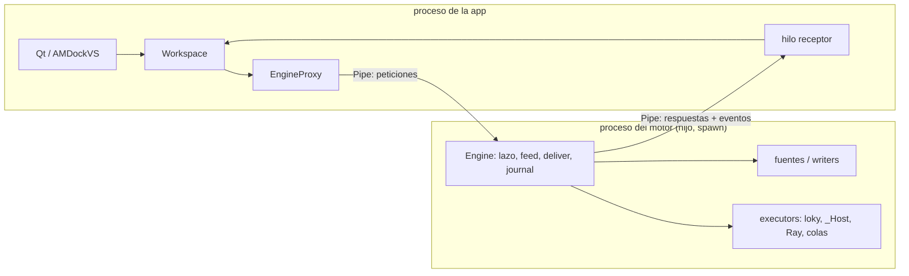

# 10 — El motor fuera del proceso de la interfaz

Estado: **plan**, 2026-11-11. Nada construido de las fases A/B.

**Decisión de Mario (2026-11-11):** el motor puede vivir en un proceso hijo, con dos condiciones:

1. Nunca un servicio: no hay proceso persistente ni puertos; nace y muere con la app.
2. La interfaz no lo gestiona: la app llama a ms_flow como hoy, y es ms_flow quien decide y maneja dónde corre su motor.

El mecanismo de IPC (pipes, colas, señales) es asunto interno de ms_flow.

## Por qué

Los `freeze_stacks.log` del laboratorio (Threadripper de 64 CPU, Ubuntu 26.04) muestran tres bloqueos de la GUI:

| dump | bloqueo | qué tenía el GIL | estado |
|---|---|---|---|
| 1 | 26 s | bindings de Vina en un hilo del proceso de la app | resuelto en 0.7.0 (`_Host`, doc 09) |
| 2 | 10 s | hilo de la GUI en un `eventFilter` de Python global; el feed en `_split_sdf_spans` (Python por línea); `_deliver` escribiendo parquet | mitigado (fase 0) |
| 3 | 10 s | la GUI en `ms_monitor _set_tasks` (11 llamadas Qt por fila y snapshot); una fuente en SQLAlchemy (`payloads.kinds`); `_deliver` en `insert_graph` | mitigado (fase 0) |

El patrón es el mismo en todos. El motor ya manda las *tareas* a otros procesos, pero el código que las alimenta y el que guarda sus resultados corren en hilos del proceso de la GUI:

- las fuentes de chunks (`job(params, project)`);
- los writers (`_writer(output, …)` → `insert_graph`, parquet);
- el lazo del motor y el journal.

Ese Python crece con el ritmo de resultados, es decir, con el número de CPUs. Cada llamada de la GUI a Qt que suelta el GIL espera hasta el switch interval para recuperarlo.

Medido con un `QApplication` offscreen, actualizando 200 filas × 5 columnas:

| hilos Python ocupados | switch interval | tiempo |
|---|---|---|
| 0 | 5 ms | 0,016 s |
| 3 | 5 ms | 0,20 – 0,45 s |
| 3 | 1 ms | 0,032 s |

Con 64 CPUs hay más hilos y más resultados; con 128, más todavía. Las mitigaciones bajan la cuenta, pero no cambian la pendiente.

## Fase 0 — mitigaciones (PRs 2026-11-11: AMDockVS #111, ms_components #47, ms_env #10, ms_toolbox #3)

- **AMDockVS `fix/lab-freezes`:**
  - `sys.setswitchinterval(0.001)`;
  - `QT_QPA_PLATFORM="xcb;wayland"` en sesiones Wayland;
  - `themed.py` escucha `paletteChanged`/`colorSchemeChanged` en lugar de un `eventFilter` global;
  - el feed de SDF calcula los offsets leyendo bloques de 1 MB con `read()` y `bytes.find`.
  Medido sobre un SDF de 4,3 GB, con un hilo que pide el GIL cada 0,5 ms:

  | divisor | caché | tiempo | espera del otro hilo p99 / máx |
  |---|---|---|---|
  | por líneas (antes) | caliente | 19 s | 218 / 355 ms |
  | `mmap.find` | fría | 7,8 s | 2,8 / 9,6 ms |
  | bloques de 1 MB | fría | 8,1 s | 1,1 / 1,6–6 ms |
  | bloques de 1 MB | caliente | 1,9 s | 1,0 / 1,4 ms |

  No se usa `mmap`: un fallo de página lee el disco con el GIL tomado, mientras que `read()` lo suelta. En NVMe cuesta 10 ms; en HDD o en red, más.
  Un SDF de 94 GB tarda ~3 min, limitado por el disco, repartido en trozos de ~1 ms. El feed además solo va `window` chunks por delante del despacho.
- **ms_components `perf/monitor-tasks-diff`:** `_set_tasks` solo reescribe las celdas que cambiaron.
- **ms_env `fix/offline-micromamba-message`:** el bootstrap descarga a un archivo y dice «¿llega este host a internet?», en vez de mostrar errores de bzip2/tar.

## Fase A — medir y dejar los jobs nombrables

1. **Sonda de lag en el repo** (`benchmarks/gui_lag/`):
   - un `QApplication` con un `QTimer` de 20 ms que registra el retraso (p50, p99, máximo);
   - corre en el mismo proceso que un `Workspace` con un import grande de SDF y un docking qvina de chunks cortos;
   - parámetro: número de workers.
   La de 2026-10-28 vivía en `/tmp` y se perdió.
2. **Medir en el Threadripper** con la fase 0 aplicada, con 16, 32 y 64 workers.
   - **Criterio:** p99 < 50 ms y máximo < 500 ms con 64 workers → la fase B queda aparcada y documentada.
   - Si no se cumple, se hace B.
3. **Jobs nombrables.** Es necesario para B y arregla un `ponytail` de `core/jobs.py:153`: un job con `result_handler_factory` no se puede reanudar.
   - Los tres factories son funciones de módulo: `io.shards.shard_queue_writer`, `chemistry` `shard_generation_writer` y `docking.shard_jobs.shard_hit_writer`.
   - Falta que el job lleve el nombre del factory y sus kwargs como JSON, en lugar de un closure.

El resto de los jobs de AMDockVS ya cruzan la frontera:

- AMDockVS llama a `workspace.submit(job, params, …)` con jobs declarados (`where` = `módulo:nombre`), params validados y sinks declarativos.
- No pasa `on_result`/`on_terminal` propios.
- `Flow.origin()` ya registra `{job, params, options}` para `resume`.

### Primera medición (PC de desarrollo, 16 CPU, 2026-11-11)

La sonda es `test/benchmarks/bench_gui_lag.py` en la rama `exp/engine-process` de AMDockVS (encima de la fase 0). Necesita jobs de AMDockVS, por eso no vive en ms_flow. Fases de 60 s:

- `dock`: Vina, 1 par por tarea, exhaustiveness 1;
- `dock+import`: lo mismo más el import de un SDF de 5 GB en frío (`POSIX_FADV_DONTNEED`).

| CPUs | switch | ventana | fase | p99 | máx | docking chunks/s | tareas dock + import |
|---|---|---|---|---|---|---|---|
| 16 | 1 ms | no | dock | 2,3 ms | 4,9 ms | 1,87 | 14 |
| 16 | 1 ms | no | dock+import | 4,6 ms | 152 ms | 1,08 | — |
| 16 | 1 ms | sí | dock+import | 4,7 ms | 156 ms | 1,05 | 8 + 6 |
| 16 | 5 ms | no | dock | 2,3 ms | 94 ms | 1,72 | 14 |
| 16 | 5 ms | sí | dock+import | 8,2 ms | 227 ms | 1,02 | 8 + 6 |
| 8 | 1 ms | sí | dock+import | 3,1 ms | 107 ms | 0,80 | 4 + 2 |

- **Criterio cumplido aquí**, con mucho margen en el p99.
- **El despacho no se satura:** con el import, el docking baja de 14 a 8 tareas, pero el total sigue en 14 (8 + 6). La caída de chunks/s es el reparto de CPUs entre los dos jobs, no el feed.
- **Los picos de 100–230 ms**, sueltos y en momentos al azar, los da el writer del import. Con `--dump-ms 80`, 6 de 7 volcados tenían el GIL en `insert_graph` (SQLAlchemy, hilo `msflow-delivery`) y 1 en un `json.dumps`. El lazo del motor estaba dormido.
- **Con 64 CPUs**, el import escribe ~4× más lotes: más picos, y el p99 puede subir. Es lo que hay que medir en el lab, con `--dump-ms 100`. Si falla, lo primero es mover las escrituras del import fuera del proceso (el writer a los workers), antes que la fase B.

En el Threadripper:

```
taskset -c 0-63 python test/benchmarks/bench_gui_lag.py --work <disco grande> --window --big-gb 60 --dump-ms 100 --out lag.jsonl
```

Repetir con `0-15` y `0-31`.

## Fase B — ms_flow hospeda su motor en un proceso hijo

### Forma



- **`Workspace` no cambia para la app.**
  - `workspace.engine` devuelve un `EngineProxy` con los 16 métodos públicos de `Engine` (`submit`, `status`, `tasks`, `chunk_states`, `jobs`, `wait`, `cancel`, `reconnect`, `register`/`unregister`/`executor`, `attach`/`detach`, `recorded`/`discard`, `close`).
  - Todos devuelven datos planos (snapshots en dataclass), así que se pueden picklear.
- **Quién elige: ms_flow.** Una opción de sus settings, `engine.host = "process" | "inline"`. Ninguna app la toca.
  - `inline` queda para tests, notebooks y scripts que pasan closures.
  - Por defecto `process`; ver Decisiones.
- **Submit = origin.** Lo que cruza es lo mismo que guarda `Flow.origin()`: nombre importable del job, params JSON y opciones. En modo `process`, un job no nombrable (lambda, closure) falla en el submit con un mensaje claro, no a mitad de la ejecución.
- **IPC:**
  - `multiprocessing.connection.Pipe` con contexto `spawn`; `fork` no es seguro con Qt cargado.
  - Peticiones con id; un hilo receptor en la app reparte las respuestas y los eventos (`on_terminal`, entregas).
  - Ese hilo solo deserializa mensajes pequeños, unos pocos Hz.
  - Si hace falta repartir eventos dentro de la app, blinker encaja ahí.
  - Sin sockets ni puertos: no es un servicio.
- **Vida del hijo:**
  - Arranca perezosamente, en el primer `open_project` o `submit`.
  - Termina con `Workspace.close()`, o solo si ve EOF en el pipe (el padre murió). En Linux, además, `PR_SET_PDEATHSIG`.
  - Si el hijo muere, el proxy lanza `EngineGone`; `Workspace` lo rearranca y los jobs reanudables siguen gracias a su journal (`reconnect`).
- **Datos:**
  - El hijo escribe la base del proyecto y los journals.
  - La app solo lee: `run_async` en hilos de la app, igual que hoy, sobre SQLite en WAL.
  - Ray (`activate`, `connect`) y las colas del HPC viven en el hijo: el driver de Ray deja de compartir el GIL con la GUI.

### Riesgos que auditar antes de construir

1. **Refrescos en vivo de la app.** Si algo se entera de los resultados por callbacks en el proceso (los «live hits» de `test_results_pivot`), necesita un evento del hijo. Hay que buscar cada uso.
2. **APIs del `Workspace` que tocan el motor en directo:** `engine.executor(...)`, `files`, `connect`/`reconnect` de hosts y la página de executors de ms_components. Todas deben pasar por el proxy.
3. **RAM.** El hijo importa los módulos de los jobs (RDKit, pyarrow, sqlalchemy), así que ~200–400 MB más. La app sigue necesitándolos para la vista.
4. **macOS:** `spawn` es el valor por defecto allí; sin `PR_SET_PDEATHSIG`, depende del EOF.
5. **Tests:** la suite de ms_flow tiene que correr en los dos modos.

### Tamaño estimado

- **ms_flow:** proxy, bucle del hijo, protocolo de eventos, rearranque y tests en dos modos. Medio-grande, del orden del doc 09 ×2.
- **AMDockVS:** solo la fase A.3 y los ajustes que salgan de la auditoría de riesgos.
- **ms_components:** nada, si el proxy es fiel.

### Construido (rama `feat/engine-child-process`, ms_flow + AMDockVS, 2026-11-11)

Lo que cambió respecto a la forma de arriba:

- **Quién elige:** `Workspace(engine_host="process" | "inline")`, o `MSFLOW_ENGINE_HOST`; por defecto `process`. No es un setting: el hijo y la app leerían settings distintos.
- **El hijo es un `Workspace` entero** (mismo `app_id`, `host_namespace`, recursos y settings) en modo `inline`. Él tiene el `Engine`, el `Flow`, el store del proyecto y los executors. La app conserva proyectos, settings y lecturas.
- **El proxy no reimplementa nada:**
  - `workspace.engine` es un `EngineProxy` (`__getattr__` → `Engine.<name>` en el hijo).
  - Los métodos del `Workspace` que tocan el motor llevan `@hosted`: `submit`, `origin`, `resume`, `move`, `activate`/`deactivate`, `save_*`/`remove_*` de hosts y executors, `node_metrics`, `queue_nodes` y `remote_jobs`, y se ejecutan en el hijo.
  - Los `lazy` corren en la app mientras no haya motor.
  - Tras `save_*`/`remove_*`, la app recarga sus settings; el hijo los recarga antes de cada uno (`SettingsManager.reload()`).
- **Todo cruza como referencia o valor, con `pickle`; ningún objeto vivo.**
  - Un job viaja por su nombre (función importable, lo mismo que pide `resume`) y sus params como valores. Lo que lee del proyecto (`project_db`, recursos, contexto) lo resuelve el lado que lo ejecuta: el writer y la fuente se construyen en el hijo, a partir de `(params, project)`. Así el payload se arma donde vive el job y un job con handler también se reanuda.
  - El writer propio de un job puede tener `on_error(key, error)` y `ended(snapshot)`: `Flow.submit` los conecta, así no viajan callbacks por submit.
  - En AMDockVS, `result_handler_factory(params, config)` reemplaza a `result_handler_kwargs`: lo que el handler necesitaba (`generation_id`, `payload`…) pasó a los params, y `project_db`/`shard_dir` vienen de `config`, que el hook `Workspace.jobs_setup` llena en el hijo.
  - Lo que no es importable (una closure, un `ProjectStore`) falla al enviarlo, en vez de copiarse en silencio. Sin cloudpickle.
  - Los callables que el otro lado llama (`on_terminal`, `on_line`, `host_env` y los argumentos de un callback) viajan como referencia (`callback()`), así que la llamada vuelve por el pipe.
- **IPC:** un `Pipe` spawn (socketpair). Cada mensaje es una petición con id; cada petición entrante se atiende en su propio hilo, en los dos sentidos. Las excepciones vuelven con el traceback remoto como nota.
- **Vida:**
  - El hijo arranca en el primer uso de `engine` y abre el proyecto activo.
  - Termina al ver EOF: cierra el proyecto y el motor, y luego `os._exit`. En Linux, además, `PR_SET_PDEATHSIG`.
  - Si muere, lo que espera recibe `EngineGone`, la app sigue en pie y el siguiente uso arranca otro hijo. `resume(key)` continúa el job desde su journal (test: SIGKILL a mitad, 400/400 filas tras el resume).
  - Con un proyecto abierto, si el hijo vivió más de 5 s, ms_flow arranca otro aparte en ese momento; este abre el journal, que marca como `interrupted` los jobs del muerto, y la app los ve así enseguida (el monitor emite `job_finished`). Si muere más joven, no se rearranca (guardia anti-bucle): el siguiente uso lo hace.
- **ms_components: nada.** Los tests de ms_flow corren en `inline` (conftest) más `tests/test_engine_host.py` en `process`.

Techos conocidos (`ponytail`), por si hacen falta:

- Los dos procesos escriben en los mismos archivos de log.
- El registro de callbacks no se libera: una entrada pequeña por callback enviado.
- Un job que murió con el hijo no recibe `on_terminal`: queda `running` hasta el `resume`.
- Una llamada al proxy desde la GUI espera al GIL del hijo: 0,11 ms en reposo. Las lecturas de la vista no pasan por ahí (van a SQLite). El hijo tarda 0,42 s en arrancar; arranca en un hilo aparte al abrir el proyecto, así que el primer submit no lo espera. Se arranca siempre desde un mismo hilo que dura lo que la aplicación: `PR_SET_PDEATHSIG` mata al hijo cuando termina el *hilo* que lo creó, no solo el proceso.
- Una copia `with_options` que cambia lo que corre el motor responde al nombre de la original: solo corre `inline`. Si solo cambia `executor`, `supported_executors` u `on_thread`, es el mismo job.
- `extra_dirs` de `open_project` no llega al hijo.

### Medición fase B (PC de desarrollo, 16 CPU)

Misma sonda y mismos parámetros que la fila «16, 1 ms, sí» de la fase A (3000 ligandos, 5 GB en frío, fases de 60 s, ventana abierta):

| motor | fase | p99 | máx | docking chunks/s | tareas dock + import |
|---|---|---|---|---|---|
| hijo | idle | 0,6 ms | 26,5 ms | — | — |
| hijo | dock | 4,2 ms | 8,5 ms | 1,50 | 14 |
| hijo | dock+import | 4,2 ms | **10,3 ms** | 0,87 | 8 + 6 |
| en la app (fase A) | dock+import | 4,7 ms | 156 ms | 1,05 | 8 + 6 |

- **Los picos desaparecen:** el máximo baja de 156 ms a 10 ms, porque `insert_graph` ya no comparte el GIL con la GUI. El de `idle` es el primer tick.
- **El docking va ~15–20 % más lento** en las dos fases, una sola corrida. Puede ser ruido o el coste del proceso extra en 16 CPU; en el lab se ve con `--engine-host inline` en la misma máquina.

## Cómo se prueba

La sonda de la fase A y, si hace falta, la fase B van en ramas `exp/engine-process` en cada repo que toquen: ms_flow seguro, y AMDockVS por A.3. Se suben **sin fusionar** para instalarlas en el lab desde la rama (`pip install git+…@exp/engine-process`). Solo se abren PRs cuando las mediciones del Threadripper digan que vale. Este doc viaja en la rama de ms_flow.

## Decisiones (Mario, 2026-11-11)

1. **`engine.host`: `process` por defecto en `Workspace`, `inline` como opción explícita** (tests, o quien pase closures).
   - Es un solo comportamiento, sin magia según haya o no una `QApplication`.
   - Los notebooks y scripts que usan `Workspace` ya envían jobs nombrables.
   - `Engine` usado directamente sigue in-process, como biblioteca.
2. **Si la fase A cumple el criterio, se queda así.** Si no, se planifica B en detalle antes de construir nada.
   La preocupación principal es que leer archivos grandes sature el despacho. Cada fuente tiene su propio hilo (`msflow-feed-N`), aparte del lazo (`msflow-engine`) y de la entrega (`msflow-delivery`), así que el despacho solo se frena por el GIL. La sonda de la fase A tiene que incluir un import grande (≥ 50 GB, en frío) junto a un docking de chunks cortos, y medir dos cosas: el lag de la GUI y los chunks despachados por segundo.
